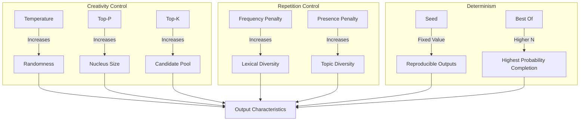
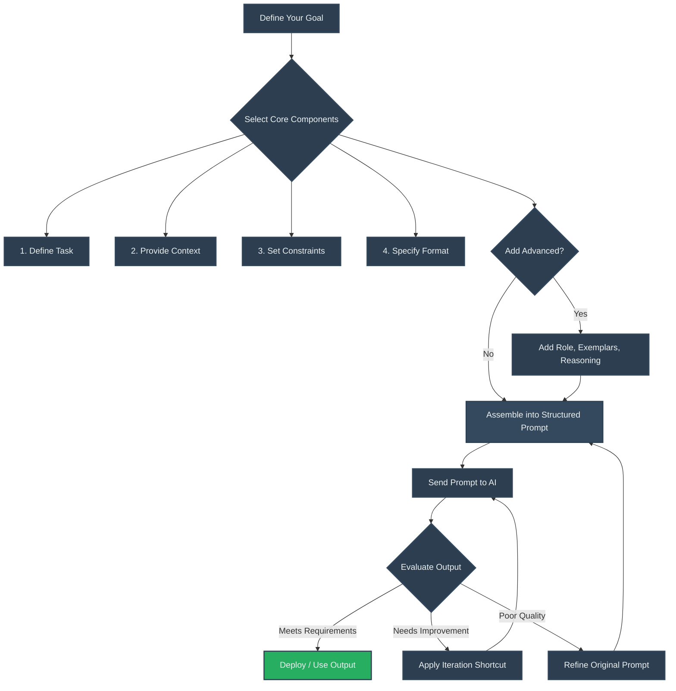
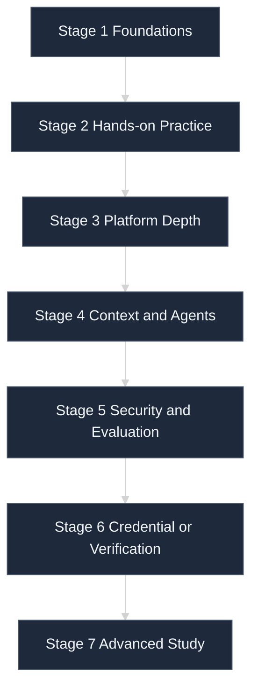

<br><br><br><br>

<h1 align="center">PROMPT ENGINEERING & AI GENERATION PARAMETERS</h1>

<br><br><br><br>

<p align="center">
    <a href="https://github.com/advancedscientificcomputing" target="_blank" rel="noopener noreferrer">
        
    </a>
</p>

<br><br>
 
 
## Table of Contents

1. [Introduction: The New Language of AI](#introduction-the-new-language-of-ai)
2. [Part One: Core Prompt Engineering](#part-one-core-prompt-engineering)
   - 1.1 The Paradigm Shift from Verbosity to Structure
   - 1.2 The Eight Core Components of a Perfect Prompt
   - 1.3 Deep Dive into Each Component
   - 1.4 Comparative Analysis of Prompting Frameworks
3. [Part Two: Advanced Prompting Techniques](#part-two-advanced-prompting-techniques)
   - 2.1 Prompt Chaining
   - 2.2 Meta-Prompting
   - 2.3 The Iteration Shortcut
   - 2.4 Retrieval-Augmented Generation (RAG)
   - 2.5 Multi-Modal Prompting
   - 2.6 Agentic Prompting and Tool Use
   - 2.7 Chain-of-Thought Prompting
   - 2.8 Tree of Thoughts
4. [Part Three: Understanding AI Generation Parameters](#part-three-understanding-ai-generation-parameters)
   - 3.1 Temperature
   - 3.2 Top-K Sampling
   - 3.3 Top-P (Nucleus Sampling)
   - 3.4 Length and Token Management
   - 3.5 Penalty Parameters
   - 3.6 Advanced Parameters
5. [Part Four: Parameter Interaction and Optimization](#part-four-parameter-interaction-and-optimization)
   - 4.1 Recommended Combinations by Use Case
   - 4.2 Parameter Relationship Diagram
6. [Part Five: Practical Workflow and Common Mistakes](#part-five-practical-workflow-and-common-mistakes)
   - 5.1 A Deployment-Ready Workflow
   - 5.2 Common Mistakes to Avoid
   - 5.3 Building a Reusable Prompt Library
7. [Appendices](#appendices)
   - A. Prompt Engineering Function Catalog
   - B. Best Practices Reference
   - C. Component Reference
   - D. Benefits Reference
   - E. Keyword Catalog
   - F. Key Terminologies
   - G. Prompt Categories
8. [Conclusion: The Future of Human-AI Communication](#conclusion-the-future-of-human-ai-communication)

<br>

<a name="introduction-the-new-language-of-ai"></a>
## Introduction: The New Language of AI

For many people, working with artificial intelligence starts with a common misunderstanding: that using more words leads to better results. The natural instinct is to write long, detailed paragraphs, hoping to paint a complete picture for the AI. However, this approach is fundamentally inefficient and often counterproductive.

Large Language Models (LLMs) do not need lengthy explanations; they need precise, structured instructions. When you use too many words, you often bury your main request in unnecessary information, forcing the AI to guess what you really want. This guessing leads to average, generic results that fail to meet your specific needs.

**The new paradigm—adopted by leading technology companies and AI researchers—is structured communication.** This approach is not about writing less; it is about writing with greater purpose and clarity. Think of it as the difference between giving someone a rambling verbal description of a house and handing them a clear architectural blueprint. The blueprint is shorter but infinitely more informative and actionable.

### What This Guide Covers

This comprehensive guide combines two essential areas of AI mastery:

1. **Prompt Engineering:** The art and science of crafting clear, effective instructions that guide AI behavior.
2. **Generation Parameters:** The technical settings that control how AI produces its responses.

By mastering both areas, you move from being a casual AI user to an expert director capable of consistently producing exceptional, tailored results.

### Who This Guide Is For

- Business professionals who use AI for writing, analysis, and communication
- Developers integrating AI into applications
- Content creators and marketers
- Students and researchers
- Anyone who wants to get better results from AI tools

The language throughout this guide is clear and accessible. You do not need a technical background to understand and apply these concepts.

<br>

<a name="part-one-core-prompt-engineering"></a>
## Part One: Core Prompt Engineering

### 1.1 The Paradigm Shift from Verbosity to Structure

When you first start using AI, your instinct is likely to write prompts like this:

> "I need you to write a really good email for me about our new software project. We are switching from our old system to a new one, and I want to tell the team about it. Make it sound exciting and not boring. We have been using Asana for two years, but now we are moving to something better. Please make it professional but friendly too."

This prompt is long, repetitive, and unclear. The AI must guess your true intent, often producing a result that misses the mark.

Now consider this structured approach:

> **Role:** You are an inspiring internal communications manager.
> **Task:** Write an announcement email to the team about switching our project management software.
> **Context:** We are moving from Asana to a new tool called "TeamFlow" to handle our growing project complexity. The goal is to generate excitement and reassure the team about the transition.
> **Tone:** Positive, confident, and helpful.
> **Format:** Professional email with a clear subject line, greeting, body, and call to action.

This version is shorter, clearer, and more likely to produce the exact email you need.

**The key insight:** Structured prompts are more efficient and effective. They give the AI exactly what it needs to produce high-quality results the first time.

<br>

### 1.2 The Eight Core Components of a Perfect Prompt

After extensive analysis of industry-leading frameworks—including the 5-Box Method, RICECO, CRISPE, and OpenAI's guidelines—we have identified eight core components that form the foundation of excellent prompts.

Not every component is needed for every prompt. Understanding their function and relative importance is the key to expert-level results.

| Rank | Component | Description | Function | Example Keywords |
| :--- | :--- | :--- | :--- | :--- |
| **1** | **Task / Instruction** | The core action you want the AI to perform. | **Mandatory.** Defines the primary goal. | `Write`, `Generate`, `Analyze`, `Summarize`, `Create`, `Translate` |
| **2** | **Context** | Background information, audience, and purpose. | **Mandatory for relevance.** Prevents generic outputs. | Target audience, project goals, relevant background data. |
| **3** | **Constraints** | Rules, boundaries, and non-negotiables for the output. | **Highly Recommended.** Guides the output with clear limits. | Word count, tone, banned topics, must-have elements. |
| **4** | **Format** | The desired structure and visual presentation. | **Highly Recommended.** Ensures immediate usability. | Table, bullet points, JSON, email, markdown, code block. |
| **5** | **Role (Persona)** | The specific expertise or perspective the AI should embody. | **Powerful shortcut.** Shifts tone and focus instantly. | "You are a senior data analyst...", "Act as a skeptical investor..." |
| **6** | **Exemplars (Examples)** | Examples of the desired output, structure, or tone. | **Highest impact for nuance.** Enables pattern matching. | "Write like this example: [text]", "Use the STAR framework like this sample." |
| **7** | **Reasoning / Chain of Thought** | The logical steps the AI should take to solve the problem. | **Essential for complex tasks.** Guides internal problem-solving. | "Break this down step-by-step.", "First, list the pros, then the cons." |
| **8** | **Tone** | The specific emotional quality or voice of the text. | **Enhances style.** A sub-component of constraints and role. | `Casual`, `Authoritative`, `Empathetic`, `Witty`, `Professional` |

<br>

### 1.3 Deep Dive into Each Component

Let us explore each component in detail with clear examples.

#### Task / Instruction

This is the engine of your prompt. Always start with a strong action verb.

- **Weak:** "I need some ideas for my blog about remote work."
- **Strong:** "Generate a list of ten blog post titles for a website focused on remote team management."

#### Context

Context transforms a generic request into a targeted assignment. It grounds the AI in your specific reality.

- **Generic:** "Write a product description for a new SaaS tool."
- **Contextualized:** "Write a product description for a new SaaS tool designed for freelance graphic designers. The tool, called 'DesignFlow,' helps them automate client invoicing and contract management. Our brand voice is friendly, supportive, and efficient."

#### Constraints

Constraints are your quality control. They prevent the AI from veering into unhelpful territory.

- **Unconstrained:** "Write a professional email."
- **Constrained:** "Write a professional email announcing a service outage. **Constraints: Max 150 words. Tone: Empathetic and apologetic. Avoid technical jargon. Include a link to our status page for updates.** "

#### Format

Specifying the format upfront saves significant time and effort.

- **Unspecified:** "Compare ChatGPT and Gemini."
- **Formatted:** "Compare ChatGPT and Gemini. **Format the output as a markdown table with the following columns: Feature, ChatGPT, Gemini. Include rows for Pricing, Context Window, Multimodal Capabilities, and Best Use Case.** "

#### Role (Persona)

The role component taps into the AI's vast training data about how specific professions communicate.

- **Without Role:** "Give me advice on getting better sleep."
- **With Role:** "**You are a board-certified sleep doctor.** Give me advice on getting better sleep." (The response becomes more evidence-based and clinical.)
- **With Role (Alternative):** "**You are a sleep-deprived parent writing a blog for other parents.** Give me advice on getting better sleep." (The response shifts to a more relatable, conversational tone.)

#### Exemplars (Examples)

One good example is worth a thousand words of instruction. This technique, known as "few-shot prompting," leverages the AI's pattern-matching capabilities.

- **Without Example:** "Proofread this document and suggest improvements. Make all changes bold."
- **With Example:** "Proofread this document and suggest improvements. Make all changes bold. **For example, if the original text was 'The quick brown fox jumps over the lazy dog,' and you changed it to 'The swift auburn fox leaps over the indolent hound,' you would present the corrected sentence with 'swift auburn leaps indolent hound' in bold.** "

#### Reasoning / Chain of Thought (CoT)

For complex, multi-step problems, instructing the AI on *how* to think is as important as telling it *what* to think about.

- **Without CoT:** "Analyze our Q3 sales data and tell me why revenue dropped."
- **With CoT:** "Analyze our Q3 sales data. **First, segment the data by product line. Then, identify which product lines had the largest revenue decrease. Next, for those product lines, analyze the trend by month. Finally, based on your analysis, hypothesize three potential reasons for the drop.** "

#### Tone

Tone is often best defined with powerful, single-word descriptors.

- **Over-described:** "Make it sound friendly, like you're talking to a friend, but also professional so people take it seriously. Don't be too casual, though."
- **Efficient:** "Tone: **Casual Authority**." (This phrase perfectly encapsulates the blend of friendliness and expertise.)

<br>

### 1.4 Comparative Analysis of Prompting Frameworks

The eight components above are the building blocks. Various popular frameworks are simply different ways of organizing these blocks. Understanding them helps you choose the best structure for your specific need.

| Framework | Core Components | Best Use Case | Key Insight |
| :--- | :--- | :--- | :--- |
| **The Unified Model** | Task, Context, Constraints, Format, Role, Exemplars, Reasoning, Tone | **The master template.** Use as a mental checklist for complex, high-stakes prompts. | All frameworks are a subset of this comprehensive list. |
| **5-Box Method** | Role, Task, Assumptions (Context), Constraints, Format | **The foundation.** Perfect for daily tasks like emails, reports, and social media posts. | A simple, robust structure that ensures you never miss the basics. |
| **RICECO** | Role, Instruction, Context, Examples, Constraints, Output | **A balanced, all-purpose framework.** Excellent for content creation and strategic planning. | Includes "Examples" as a core element, making it powerful for replicating specific styles. |
| **CRISPE** | Context, Role, Instruction, Specifications, Performance, Example | **Optimized for performance and quality standards.** Ideal for tasks with measurable outcomes. | Adds a "Performance" layer, defining what success looks like in concrete terms. |
| **OpenAI 7-Step** | Role, Task, Context, Reasoning, Rules, Stop Condition, Output Style | **Designed for advanced, multi-step logic.** Perfect for complex research and analysis. | Introduces "Reasoning" and "Stop Condition" for fine-grained control. |

<br>

<a name="part-two-advanced-prompting-techniques"></a>
## Part Two: Advanced Prompting Techniques

Beyond the core components, these advanced techniques will elevate your prompting to an expert level.

### 2.1 Prompt Chaining

Instead of writing one large, complex prompt, break the task into a sequence of smaller, logical steps. This is **Prompt Chaining**. It manages complexity by guiding the AI through a process, using the output of one step as the input for the next.

- **Mega-Prompt (Inefficient):** "Write a comprehensive marketing strategy for a new app."
- **Prompt Chain (Efficient and Controlled):**
  1. "List the top five challenges faced by users of productivity apps." (Output: List)
  2. "Based on this list, suggest three core value propositions for a new productivity app." (Output: Value Propositions)
  3. "For the second value proposition, create a one-month content marketing plan with weekly themes." (Output: Detailed Plan)

### 2.2 Meta-Prompting

This is the ultimate efficiency hack: asking the AI to help you build a better prompt. Use **Meta-Prompting** to convert your rambling thoughts into a structured format.

- **Your Raw Input:** "I need a really good email to send to my team about our new project management software, but I want it to sound exciting and not boring. We're switching from Asana. What's the best way to ask ChatGPT to write this for me?"
- **Meta-Prompt:** "Rewrite my request into a clear, concise, and structured prompt for an AI. Use the core components of role, task, context, and tone."
- **AI's Output (The New Prompt):** "**Role:** You are an inspiring and clear internal communications manager. **Task:** Write an announcement email to the team about switching our project management software. **Context:** We are moving from Asana to a new tool called 'TeamFlow' to better handle our increasing project complexity. The goal is to generate excitement and reassure the team about the transition. **Tone:** Positive, confident, and helpful."

### 2.3 The Iteration Shortcut

You do not need to start over to refine an output. Use short, powerful commands in follow-up messages to steer the AI.

- **First Output:** A blog post that is too formal.
- **Iteration Command:** "More casual. Add a rhetorical question."
- **Result:** The AI revises the output based on the existing context, saving you the time of rewriting the entire prompt.

### 2.4 Retrieval-Augmented Generation (RAG)

**Retrieval-Augmented Generation (RAG)** is a technique where you provide the AI with specific, relevant information from your own documents or databases before asking it to generate a response. This grounds the AI in factual, up-to-date information that may not be part of its training data.

**How It Works:**
1. You identify the relevant information from your documents.
2. You include this information in your prompt.
3. The AI uses this provided information to generate its response.

**Practical Example:**
- **Without RAG:** "Write a summary of our company's Q3 financial results."
- **With RAG:** "Here is our Q3 financial data: [insert actual numbers]. Write a summary of these results, highlighting the key trends and areas of concern."

**Why It Matters:** RAG reduces hallucinations (AI making things up) and ensures your outputs are based on accurate, current information.

### 2.5 Multi-Modal Prompting

Modern AI models can process not just text but also images, audio, and video. **Multi-Modal Prompting** involves using multiple types of input to get better results.

**Practical Example:**
- Instead of: "Describe this chart."
- Try: "Here is a chart showing our sales data [upload image]. Analyze this chart and write a one-page summary of the trends, comparing Q3 to Q2 performance."

**Best Practices:**
- Clearly label each input type (e.g., "Image 1:", "Text Document 1:").
- Explain what you want the AI to do with each input.
- Be specific about how the different inputs relate to each other.

### 2.6 Agentic Prompting and Tool Use

**Agentic prompting** involves instructing the AI to act as an autonomous agent that can use external tools, make decisions, and take actions to achieve a goal. This represents the frontier of AI interaction.

**Practical Example:**
> "Act as a research agent. Your task is to gather information about the latest developments in renewable energy. Use these tools: web search to find recent articles, text analysis to extract key findings, and summarization to create a comprehensive report. You have 10 minutes of work time. Present your findings as a bulleted report with citations."

**Key Considerations:**
- Define the agent's goals clearly.
- Specify which tools it can use.
- Set boundaries and constraints.
- Define what success looks like.

### 2.7 Chain-of-Thought (CoT) Prompting

**Definition:** A technique that instructs the model to articulate its reasoning process step-by-step before delivering the final answer. This mirrors human problem-solving and significantly improves performance on complex logical, mathematical, and multi-step tasks.

| Aspect | Description |
| :--- | :--- |
| **Core Idea** | Force the model to "show its work" before concluding. |
| **Typical Format** | "Let's think step by step." or "First, [step 1]. Then, [step 2]..." |
| **Why It Works** | Reasoning steps create a scratchpad that helps the model maintain coherence and catch errors. |

**Example:**
- *Standard Prompt:* "A bat and a ball cost $1.10. The bat costs $1.00 more than the ball. How much does the ball cost?" (Many models incorrectly answer $0.10)
- *Chain-of-Thought Prompt:* "A bat and a ball cost $1.10. The bat costs $1.00 more than the ball. Let's think step by step: If the ball costs X, then the bat costs X + $1.00. Together, X + (X + $1.00) = $1.10. So 2X + $1.00 = $1.10. Then 2X = $0.10. So X = $0.05. Therefore, the ball costs $0.05."

**Variants:**
- **Zero-Shot CoT:** Simply adding "Let's think step by step" to any prompt.
- **Few-Shot CoT:** Providing examples of reasoning chains before the target question.

### 2.8 Tree of Thoughts (ToT)

**Definition:** An advanced reasoning framework that generalizes Chain-of-Thought by exploring multiple reasoning paths at each step, evaluating their promise, and branching or pruning accordingly. The model "thinks" in a tree structure rather than a single line.

| Concept | Description |
| :--- | :--- |
| **Thought Decomposition** | Break the problem into intermediate steps or "thoughts." |
| **Thought Generation** | Generate multiple possible next thoughts from each current state. |
| **State Evaluation** | Evaluate whether each thought leads toward a solution (heuristic scoring). |
| **Search Algorithm** | Use BFS, DFS, or beam search to explore the most promising branches. |

**Use Cases:**
- Creative writing (exploring plot branches)
- Complex planning problems
- Puzzle solving (e.g., Sudoku, crosswords)
- Strategic decision-making

<br>

<a name="part-three-understanding-ai-generation-parameters"></a>
## Part Three: Understanding AI Generation Parameters

While prompt engineering tells the AI *what* to do, generation parameters control *how* it does it. These are mathematical settings that influence how the AI selects each word during the response creation process. Understanding these parameters gives you fine-grained control over the creativity, predictability, and structure of your outputs.

### 3.1 Temperature

**Definition:** Temperature controls the randomness of the model's token selection. It is a floating-point value, typically ranging from 0.0 to 2.0.

| Temperature Value | Behavior | Best Use Cases |
| :--- | :--- | :--- |
| **0.0 - 0.3** | **Low randomness, highly deterministic.** The model consistently chooses the most probable next token. | Factual responses, coding, data extraction, translation, tasks requiring precision and consistency. |
| **0.4 - 0.7** | **Balanced creativity.** Moderate randomness allows for varied phrasing while maintaining coherence and relevance. | General content creation, email drafting, brainstorming, summarization. |
| **0.8 - 1.2** | **High creativity, increased randomness.** The model explores less probable tokens, leading to surprising and novel outputs. | Creative writing, poetry, story generation, marketing taglines, idea generation. |
| **> 1.2** | **Very high randomness, potential incoherence.** Outputs may become chaotic or drift from the prompt. | Experimental use, surrealist content (use with caution). |

**How It Works:** At each step of generation, the model calculates a probability distribution over all possible next tokens. Temperature scales these probabilities. A low temperature makes high-probability tokens even more likely, while a high temperature gives lower-probability tokens a greater chance of being selected.

**Practical Example:**
- *Prompt:* "The capital of France is"
- *Temperature 0.2:* "Paris." (The most likely token, chosen consistently)
- *Temperature 0.8:* "Paris, a city known for its art and culture." (Still correct, but adds creative elaboration)
- *Temperature 1.5:* "a baguette-wielding mime named Pierre who governs from the Eiffel Tower." (Creative, but factually incorrect)

**Important Note:** This document was generated with **Temperature = 0.2**, ensuring precise, deterministic, and factual outputs.

<br>

### 3.2 Top-K Sampling

**Definition:** Top-K restricts the model's token selection to the **K most likely next tokens**. The probability distribution is then renormalized across only these top K candidates.

| K Value | Behavior | Best Use Cases |
| :--- | :--- | :--- |
| **1** | **Greedy decoding.** Always chooses the single most probable token. Equivalent to temperature 0. | Highly deterministic tasks, when you want the most "obvious" completion. |
| **10 - 30** | **Moderate restriction.** Removes very low-probability outliers while maintaining reasonable variety. | General purpose, balanced between coherence and diversity. |
| **40 - 100** | **Minimal restriction.** Allows for a wide range of tokens, increasing creativity and unpredictability. | Creative writing, when exploring unusual phrasings is desired. |
| **0 or not set** | **No restriction.** Considers all possible tokens in its vocabulary. | Default behavior in many systems; maximum flexibility. |

**How It Works:** Imagine the model's vocabulary has 50,000 possible tokens. With Top-K = 40, the model identifies the 40 most probable tokens, discards all others, and then samples from this reduced set. This prevents the model from selecting highly improbable, off-topic tokens.

**Practical Example:**
- *Prompt:* "The cat sat on the"
- *Top-K = 1:* Always selects: "mat."
- *Top-K = 10:* Selects from top 10 candidates: "mat," "floor," "couch," "rug," "chair," etc.
- *Top-K = 100:* Allows broader choices like "windowsill" or "keyboard."

<br>

### 3.3 Top-P (Nucleus Sampling)

**Definition:** Top-P selects the smallest set of tokens whose cumulative probability exceeds the threshold **P**. Unlike Top-K, which takes a fixed number of tokens, Top-P takes a dynamic number based on the probability distribution.

| P Value | Behavior | Best Use Cases |
| :--- | :--- | :--- |
| **0.1 - 0.3** | **Highly focused.** The model selects from a very small, high-probability nucleus. | Factual tasks, coding, when you want tight adherence to the most likely completions. |
| **0.4 - 0.7** | **Balanced.** The nucleus expands to include a reasonable range of probable tokens. | General conversation, content generation, summarization. |
| **0.8 - 0.95** | **Broad and creative.** The nucleus includes many tokens, allowing for diverse and surprising outputs. | Creative writing, brainstorming, generating multiple alternatives. |
| **1.0** | **No restriction.** Equivalent to sampling from the full distribution. | Maximum flexibility, but risks including very low-probability tokens. |

**How It Works:** The model sorts tokens by probability descending and adds them to the "nucleus" until the sum of their probabilities reaches P. For example:
- If probabilities are highly skewed: The top 5 tokens might reach 90%, creating a small nucleus.
- If probabilities are more uniform: The top 50 tokens might be needed to reach 90%, creating a larger nucleus.

**Relationship Between Top-K and Top-P:** These parameters are often used together. A common configuration is to set Top-K to a high value (e.g., 50) to eliminate extreme outliers, and then use Top-P (e.g., 0.9) for fine-grained control within that filtered set.

<br>

### 3.4 Length and Token Management

#### Max Tokens

**Definition:** The maximum number of tokens (words or subwords) the model can generate in a single response.

| Token Count | Approximate Word Count | Best Use Cases |
| :--- | :--- | :--- |
| **50 - 100** | 35 - 75 words | Short replies, social media posts, email subject lines, classifications. |
| **150 - 300** | 110 - 225 words | Email bodies, product descriptions, short summaries, LinkedIn posts. |
| **500 - 1000** | 375 - 750 words | Blog posts, article drafts, detailed explanations, meeting agendas. |
| **2000 - 4000+** | 1500 - 3000+ words | Long-form content, research papers, story chapters, comprehensive analysis. |

**Important Considerations:**
- **Token ≠ Word:** One token is approximately 0.75 words for English text.
- **Context Window vs. Max Tokens:** The context window is the total memory of the conversation. If your prompt is 3,000 tokens and the context window is 4,000, your max tokens cannot exceed 1,000.
- **Cost Implications:** Many APIs charge by the token. Setting a lower max tokens can reduce costs.

#### Stop Sequences

**Definition:** A list of strings that, when generated, tells the model to halt generation immediately. The stop sequence itself is not included in the final output.

| Use Case | Example Stop Sequences | Purpose |
| :--- | :--- | :--- |
| **List Generation** | `["\n\n", "11."]` | Stop after 10 items, preventing continuation beyond the requested count. |
| **Code Generation** | `["```", "'''"]` | Stop after closing a code block, preventing additional explanations. |
| **Step-by-Step Instructions** | `["Step 6:", "Conclusion"]` | Stop after a specific number of steps. |
| **Question-Answering** | `["\n\nQ:", "\n\nNext question:"]` | Stop before the model generates the next Q&A pair. |

**Pro Tip:** Stop sequences are invaluable for creating predictable, parsable outputs, especially when integrating AI responses into automated workflows.

<br>

### 3.5 Penalty Parameters

#### Frequency Penalty

**Definition:** Reduces the likelihood of repeating the same tokens or phrases that have already appeared in the generated text.

| Frequency Penalty | Behavior | Best Use Cases |
| :--- | :--- | :--- |
| **0.0** | **No penalty.** The model may repeat words as often as statistically likely. | Technical writing where precise terminology requires repetition. |
| **0.1 - 0.5** | **Mild penalty.** Reduces minor repetition while allowing necessary terms to repeat. | General content, where you want natural variation. |
| **0.6 - 1.0** | **Strong penalty.** Actively discourages repetition, forcing varied vocabulary. | Creative writing, poetry, when you want rich, diverse language. |
| **> 1.0** | **Extreme penalty.** May lead to unnatural phrasing. | Experimental use only. |

**Practical Example:**
- *Without penalty:* "The company's product is a great product that solves product-related issues."
- *With frequency penalty:* "The company's offering is an excellent solution that addresses common industry challenges."

#### Presence Penalty

**Definition:** Penalizes tokens based on whether they have appeared at all in the generated text, regardless of frequency. Encourages the model to introduce new topics and concepts.

| Presence Penalty | Behavior | Best Use Cases |
| :--- | :--- | :--- |
| **0.0** | **No penalty.** The model may stay within a narrow set of concepts. | Focused technical explanations, staying on topic. |
| **0.1 - 0.5** | **Mild encouragement to diversify.** The model will introduce new concepts but remains grounded. | Balanced content, exploring subtopics while maintaining focus. |
| **0.6 - 1.0** | **Strong encouragement to explore.** The model actively seeks new angles and concepts. | Brainstorming, ideation, when you want broad coverage. |
| **> 1.0** | **Extreme diversification.** May lead to scattered, unfocused content. | Creative exploration, but risk of topic drift. |

**Frequency Penalty vs. Presence Penalty: Key Differences**

| Aspect | Frequency Penalty | Presence Penalty |
| :--- | :--- | :--- |
| **Penalty Basis** | How many times a token has appeared | Whether a token has appeared at all |
| **Primary Effect** | Reduces word-level repetition | Encourages topic diversification |
| **Best For** | Improving vocabulary variety within a topic | Expanding the breadth of content across topics |
| **Use Together?** | Yes, they are complementary. | |

<br>

### 3.6 Advanced Parameters

#### Logit Bias

**Definition:** Directly modifies the probability of specific tokens before sampling. You can increase or decrease the likelihood of particular words appearing in the output.

| Bias Value | Effect | Use Cases |
| :--- | :--- | :--- |
| **-100 to -1** | **Negative bias.** Decreases probability; -100 effectively bans the token. | Blocking offensive terms, preventing specific words, avoiding brand names. |
| **0** | **No bias.** Token probability unchanged. | Default state. |
| **1 to 100** | **Positive bias.** Increases probability; 100 forces the token to be chosen if possible. | Ensuring specific terminology, enforcing brand voice, guiding topic focus. |

**Important Note:** Logit bias requires knowing token IDs, which vary by model. It is primarily used in API integrations, not consumer interfaces.

#### Seed

**Definition:** An integer value that initializes the random number generator used in sampling. Setting a specific seed makes generation **deterministic**.

| Seed Setting | Behavior | Best Use Cases |
| :--- | :--- | :--- |
| **Not set / random** | Non-deterministic. Each run may produce different results. | Exploration, creative tasks, when variety is desired. |
| **Fixed integer** | Deterministic. Repeated runs produce identical outputs. | Testing, debugging, A/B testing prompts, reproducible research. |

**Practical Example:**
- *Run 1 with seed=123:* Generates "The majestic mountains towered over the valley."
- *Run 2 with seed=123:* Generates exactly the same sentence.
- *Run 3 with no seed:* Generates something different.

#### Best Of

**Definition:** Instructs the model to generate **N** completions internally and return the one with the highest probability.

| Best Of Value | Behavior | Best Use Cases |
| :--- | :--- | :--- |
| **1** | **Single generation.** Returns the first completion. | Default behavior, fastest response. |
| **2 - 5** | **Multiple internal candidates.** Returns the best one. | When quality is more important than speed. |
| **> 5** | **Extensive internal search.** Diminishing returns for computational cost. | Critical tasks where the absolute best possible output is required. |

**Cost Implication:** Best Of multiplies the computational cost. Generating 3 completions internally costs approximately 3 times as much as a single generation.

<br>

<a name="part-four-parameter-interaction-and-optimization"></a>
## Part Four: Parameter Interaction and Optimization

Understanding how parameters interact is crucial for achieving desired results. Here are common configurations for different use cases.

### 4.1 Recommended Combinations by Use Case

| Use Case | Temperature | Top-P | Top-K | Frequency Penalty | Presence Penalty | Reasoning |
| :--- | :--- | :--- | :--- | :--- | :--- | :--- |
| **Factual Q&A** | 0.1 - 0.3 | 0.1 - 0.3 | 10 - 20 | 0.0 - 0.1 | 0.0 | Maximize accuracy and determinism; minimal creativity. |
| **Code Generation** | 0.2 - 0.4 | 0.3 - 0.5 | 20 - 40 | 0.0 - 0.2 | 0.0 - 0.1 | Balance correctness with minor variations in implementation. |
| **Business Writing** | 0.4 - 0.6 | 0.5 - 0.7 | 30 - 50 | 0.1 - 0.3 | 0.1 - 0.3 | Professional tone with natural variation; avoid repetition. |
| **Creative Writing** | 0.7 - 0.9 | 0.8 - 0.95 | 50 - 100 | 0.3 - 0.5 | 0.3 - 0.5 | Encourage creativity while maintaining coherence. |
| **Brainstorming** | 0.8 - 1.0 | 0.9 - 1.0 | 100+ | 0.4 - 0.7 | 0.5 - 0.8 | Maximize diversity of ideas; accept some off-topic results. |
| **Translation** | 0.1 - 0.3 | 0.1 - 0.3 | 10 - 20 | 0.0 | 0.0 | Fidelity to source text is paramount. |
| **Summarization** | 0.3 - 0.5 | 0.4 - 0.6 | 30 - 50 | 0.1 - 0.2 | 0.1 - 0.2 | Accurate condensation with slight phrasing variety. |
| **Technical Documentation** | 0.2 | 0.2 | 15 | 0.1 | 0.1 | Precise, deterministic, factual. |

### 4.2 Parameter Relationship Diagram



<br>

<a name="part-five-practical-workflow-and-common-mistakes"></a>
## Part Five: Practical Workflow and Common Mistakes

### 5.1 A Deployment-Ready Workflow

To consolidate everything, here is a step-by-step workflow that you can use immediately.



**Step-by-Step Guide:**

1. **Define Your Goal:** What is the ultimate purpose? What problem are you solving?
2. **Select Core Components:** Start with Task, Context, Constraints, and Format.
3. **Add Advanced Components (Optional):** Layer in Role, Exemplars, or Reasoning for complex tasks.
4. **Assemble into Structured Prompt:** Combine your chosen components into a logically organized prompt.
5. **Send Prompt to AI:** Execute your prompt.
6. **Evaluate Output:** Critically assess the result against your original goal.
7. **Iterate or Refine:**
   - If the output is close but needs tweaks, use **Iteration Shortcuts**.
   - If the output is fundamentally off, **Refine the Original Prompt**.
8. **Deploy:** Once the output meets your standards, it is ready to use.

<br>

### 5.2 Common Mistakes to Avoid

| Mistake | Explanation | Solution |
| :--- | :--- | :--- |
| **Cutting Context, Not Fluff** | Being concise does not mean omitting essential information. | Keep vital context like audience, purpose, and background. |
| **Over-Compressing Complex Tasks** | Trying to cram complex, multi-faceted tasks into one short prompt fails. | Use **Prompt Chaining** to break tasks into logical steps. |
| **Ignoring Output Format** | Omitting format often results in a poorly structured block of text. | Always specify the final format to save time and frustration. |
| **Setting Temperature Too High for Factual Tasks** | High temperature introduces randomness that can make factual outputs incorrect. | Use temperature 0.2 - 0.3 for factual and technical content. |
| **Using Inconsistent Parameters** | Conflicting parameter settings can produce unpredictable results. | Use recommended combinations from the configuration matrix. |
| **Forgetting Token Limits** | Exceeding token limits truncates outputs. | Monitor token usage and set appropriate max_tokens values. |

<br>

### 5.3 Building a Reusable Prompt Library

One of the most effective strategies for long-term success is building a library of reusable prompts. This saves time and ensures consistency across your organization.

**How to Build Your Library:**

1. **Document Your Best Prompts:** Save prompts that produce excellent results.
2. **Categorize by Use Case:** Group them by purpose (e.g., "Email," "Blog Posts," "Code Generation," "Data Analysis").
3. **Include Parameters:** Note the temperature, Top-P, and other settings that work best.
4. **Add Notes:** Include information about when and how to use each prompt.
5. **Version Control:** Track changes and improvements over time.

**Example Template for Your Library:**

| Prompt Name | Use Case | Prompt Template | Recommended Parameters | Notes |
| :--- | :--- | :--- | :--- | :--- |
| "Product Announcement Email" | Internal communications | Role: [role], Task: [task], Context: [context], Tone: [tone] | Temperature: 0.4, Top-P: 0.5 | Tested with team; consistent results. |
| "Blog Post Outline" | Content creation | Generate a blog post outline for [topic]. Include H1, H2, and H3 headings. | Temperature: 0.7, Top-P: 0.8 | Good for brainstorming. |

<br>

<a name="appendices"></a>
## Appendices

### A. Prompt Engineering Function Catalog

| No. | Category | Function | Definition |
| --: | :--- | :--- | :--- |
| 1 | Extraction | Extraction | Isolate and return specific data points or text spans (e.g., dates, amounts, IDs). |
| 2 | Extraction | Named Entity Recognition (NER) | Identify and label named entities such as persons, organizations, locations, products, and dates. |
| 3 | Extraction | Entity Linking | Resolve detected entities to canonical identifiers in a knowledge base. |
| 4 | Extraction | Intent Detection | Determine the user's high-level goal or intent expressed in text. |
| 5 | Extraction | Slot Filling | Populate structured fields required to fulfill an identified intent. |
| 6 | Extraction | Classification | Assign text to one or more predefined categories or labels. |
| 7 | Extraction | Topic Identification / Topic Modeling | Detect dominant topics or latent themes within documents. |
| 8 | Extraction | Keyword Extraction | Extract salient words or phrases that summarize content. |
| 9 | Extraction | Schema Mapping & Slot Validation | Map unstructured text to a target schema and validate field types and constraints. |
| 10 | Extraction | Sentiment Analysis | Assess polarity (positive/neutral/negative) and intensity of opinion. |
| 11 | Extraction | Emotion Detection | Identify granular emotions (joy, anger, sadness, etc.). |
| 12 | Transformation | Paraphrasing | Rephrase text while preserving original meaning and intent. |
| 13 | Transformation | Translation | Convert text between languages while preserving meaning and register. |
| 14 | Transformation | Style & Tone Control | Modify text to match a specified voice, formality, or tone. |
| 15 | Transformation | Length Control | Constrain output to a target length (tokens, characters, or sentences). |
| 16 | Transformation | Content Inclusion | Require inclusion of specified facts, terms, or phrases in the output. |
| 17 | Transformation | Content Exclusion | Enforce omission of specified words, topics, or sensitive details. |
| 18 | Transformation | Replacement / Transformation | Substitute or transform tokens, phrases, or structures according to rules. |
| 19 | Transformation | Formatting & Normalization | Produce or normalize structured formats (JSON/CSV/Markdown) and standardize dates/casing. |
| 20 | Transformation | Spell & Grammar Correction | Detect and correct orthographic and grammatical errors. |
| 21 | Transformation | Instruction Simplification | Convert complex procedures into simpler, actionable steps. |
| 22 | Transformation | Modality Conversion Prompts | Prepare or convert text for other modalities (alt-text, TTS-ready text, STT preprocessing). |
| 23 | Generation & Synthesis | Summarization | Condense content while preserving core meaning (extractive or abstractive). |
| 24 | Generation & Synthesis | Rationale / Explanation Generation | Produce concise justifications or stepwise reasoning for outputs. |
| 25 | Generation & Synthesis | Controlled / Constrained Generation | Enforce policy, schema, or domain constraints on generated text. |
| 26 | Generation & Synthesis | Few-shot / In-context Learning | Guide model behavior by providing exemplar input–output pairs. |
| 27 | Generation & Synthesis | Chain-of-Thought / Stepwise Decomposition | Elicit intermediate reasoning steps for complex tasks. |
| 28 | Generation & Synthesis | Retrieval-Augmented Generation (RAG) Prompting | Inject retrieved documents or facts to ground outputs. |
| 29 | Generation & Synthesis | Prompt Templating & Parameterization | Create reusable prompt templates with variable placeholders. |
| 30 | Generation & Synthesis | Multi-task / Composite Prompting | Request multiple related tasks or outputs in a single prompt. |
| 31 | Generation & Synthesis | Data Augmentation via Prompting | Synthesize labeled examples for training or testing. |
| 32 | Orchestration | Orchestration / Prompt Chaining | Sequence multiple prompts or model calls to implement multi-step pipelines. |
| 33 | Orchestration | Dialogue Management | Control turn-taking, context windows, and system persona across conversational flows. |
| 34 | Safety & Compliance | Safety Filtering & Moderation | Detect and block generation of disallowed or harmful content. |
| 35 | Safety & Compliance | Bias Mitigation Prompting | Apply counterfactuals, constraints, or balancing techniques to reduce model bias. |
| 36 | Safety & Compliance | Regulatory & Policy Compliance Prompting | Embed domain-specific legal and privacy constraints (e.g., data minimization) into prompts. |
| 37 | Observability & Governance | Cost & Token Optimization | Structure prompts to minimize token usage and inference cost. |
| 38 | Observability & Governance | Test & Evaluation Prompting | Generate test cases, scoring criteria, and evaluation instructions for validation. |
| 39 | Observability & Governance | Monitoring & Logging Hooks | Embed markers or metadata in prompts for traceability and observability. |
| 40 | Observability & Governance | Explainable / Auditable Prompting | Design prompts that produce outputs easy to audit and justify. |

<br>

### B. Best Practices Reference

| No. | Best Practice | Definition |
| --: | :--- | :--- |
| 1 | Clear Objectives | Define the exact goal and measurable success criteria for the model interaction before crafting the prompt. |
| 2 | Specify Output Format | Explicitly require the response structure or schema (e.g., JSON, CSV, bullets) you expect. |
| 3 | Provide Minimal Necessary Context | Include only the contextual facts required for the task to avoid noise and ambiguity. |
| 4 | Be Concise and Unambiguous | Use short, precise instructions; avoid vague, overloaded, or multi-meaning phrasing. |
| 5 | Use Constraints and Guardrails | Enforce hard constraints (length, forbidden words, schema rules) to limit undesired outputs. |
| 6 | Give Examples (Few-shot) | Provide representative input–output exemplars to demonstrate the desired behavior. |
| 7 | Choose Zero/One/Few-shot Intentionally | Select the demonstration strategy that matches task complexity and model capability. |
| 8 | Control Model Parameters | Tune temperature, max tokens, top_p, and similar settings to match creativity vs. determinism needs. |
| 9 | Ask for Stepwise Reasoning When Needed | Request decomposition or chain-of-thought only when transparent, testable reasoning is required. |
| 10 | Require Rationales Sparingly | Ask for brief justifications when auditability matters; avoid unnecessary rationale requests that increase hallucination risk. |
| 11 | Anchor Time & Scope | State relevant dates, locales, or dataset versions to prevent temporal or scope ambiguity. |
| 12 | Enforce Safety & Moderation Rules | Embed content policies and filters in prompts to block disallowed or harmful outputs. |
| 13 | Minimize Sensitive Data Exposure | Apply data-minimization: avoid including PII, secrets, or other sensitive content in prompts. |
| 14 | Use Retrieval / RAG for Grounding | Supply vetted external context or documents when factual grounding is required. |
| 15 | Validate and Sanitize Inputs | Preprocess and validate user inputs to remove ambiguity, injection risks, or malformed data. |
| 16 | Use Prompt Templates & Parameterization | Create reusable, parameterized templates for consistent and maintainable prompts. |
| 17 | Version and Registry Prompts | Track prompt versions, ownership, and change history for reproducibility and rollback. |
| 18 | Monitor Cost & Token Usage | Optimize prompt length and content to control inference cost and latency. |
| 19 | Test with Diverse Cases | Evaluate prompts on representative, edge, and adversarial examples to surface failure modes. |
| 20 | Instrument Logging & Observability | Add metadata markers to enable tracing, debugging, and post-hoc analysis. |
| 21 | A/B Test Prompt Variants | Measure performance differences between prompt designs using defined metrics. |
| 22 | Define Evaluation Metrics | Use objective metrics (accuracy, F1, ROUGE, schema adherence) aligned to success criteria. |
| 23 | Implement Human-in-the-Loop | Route uncertain or high-risk outputs to humans for verification, correction, or escalation. |
| 24 | Limit Hallucination with Verification | Ask the model to cite sources or verify facts against provided context or retrieval. |
| 25 | Use Controlled Vocabularies / Ontologies | Restrict outputs to known terms or categories when consistency and mapping are required. |
| 26 | Design for Explainability | Prefer prompts that produce traceable outputs and concise rationales for auditability. |
| 27 | Reduce Bias via Prompt Design | Counterbalance prompts with diverse examples, neutrality instructions, or explicit fairness constraints. |
| 28 | Apply Prompt Chaining for Complexity | Break complex workflows into discrete, testable prompt steps with clear interfaces. |
| 29 | Use Role and Persona Prompts Carefully | Assign roles only when useful, and constrain them to avoid overfitting to persona quirks. |
| 30 | Keep Prompts Stateless When Appropriate | Prefer stateless prompts or explicit context passing to avoid implicit drift in long sessions. |
| 31 | Document Prompts & Assumptions | Record prompt intent, assumptions, known limitations, and failure modes for team knowledge transfer. |
| 32 | Collaborate Cross-Functionally | Involve domain experts, ethicists, UX designers, and engineers when designing production prompts. |

<br>

### C. Component Reference

| No. | Component | Definition |
| --: | :--- | :--- |
| 1 | Task Definition | Precisely state the action the model must perform and the desired outcome. |
| 2 | Context Provision | Supply the minimal, relevant background information the model needs to produce correct results. |
| 3 | Exemplars / Examples | Provide representative input–output samples that demonstrate desired behavior. |
| 4 | Persona / Role Specification | Define the voice, expertise, or role the model should assume. |
| 5 | Output Format Specification | Declare the exact structure, schema, or formatting required (e.g., JSON, table, bullets). |
| 6 | Tone & Style Instruction | Specify the required tone, register, and writing style. |
| 7 | Constraints & Guardrails | Impose hard rules (forbidden terms, length limits, schema constraints) to prevent undesirable outputs. |
| 8 | Parameter Settings | Choose inference parameters (temperature, max tokens, top_p) that align with creativity and determinism needs. |
| 9 | Few-/Zero-/One-shot Strategy | Select and configure a demonstration strategy appropriate for task complexity. |
| 10 | Retrieval / Grounding Context | Attach vetted documents or retrieved evidence to anchor factual claims. |
| 11 | Prompt Template & Variableization | Build reusable templates with placeholders for dynamic inputs. |
| 12 | Chaining & Orchestration | Decompose complex tasks into sequenced prompts or microservices with clear interfaces. |
| 13 | Stepwise Decomposition / Chain-of-Thought | Request intermediate steps to solve multi-step reasoning tasks transparently (use only when needed). |
| 14 | Input Validation & Sanitization | Preprocess and validate inputs to remove ambiguity, injection risks, or malformed data. |
| 15 | Safety & Moderation Hooks | Embed policy checks and filters to detect or block harmful content. |
| 16 | Verification & Source Citation | Require explicit verification steps or citations when factual accuracy is critical. |
| 17 | Testing & Evaluation Harness | Define test cases, benchmarks, and metrics for prompt validation. |
| 18 | Monitoring & Observability Markers | Include traceable metadata for logging, debugging, and performance analysis. |
| 19 | Versioning & Registry | Track prompt versions, ownership, and change history for reproducibility and governance. |
| 20 | Cost & Token Optimization | Design prompts to minimize token usage and inference cost without degrading quality. |
| 21 | Human-in-the-Loop Integration | Specify escalation, review, or correction workflows for uncertain or high-risk outputs. |
| 22 | Bias Mitigation Controls | Add explicit instructions or counterexamples to reduce predictable bias in outputs. |
| 23 | Documentation & Assumptions | Record intent, constraints, known limitations, and expected failure modes for each prompt component. |

<br>

### D. Benefits Reference

| No. | Benefit | Definition |
| --: | :--- | :--- |
| 1 | Accuracy Improvement | Increase the correctness of model outputs by constraining scope and supplying relevant context. |
| 2 | Consistency | Produce uniform responses across similar inputs by enforcing format, style, and content rules. |
| 3 | Reduced Hallucination | Lower fabrication of unsupported facts by grounding prompts and requiring verification. |
| 4 | Efficiency | Decrease iteration time and compute waste by crafting precise, targeted prompts. |
| 5 | Cost Reduction | Minimize inference cost through token- and prompt-length optimization. |
| 6 | Faster Iteration | Enable quicker refinement cycles by using templates, parameterization, and few-shot examples. |
| 7 | Better Safety & Compliance | Embed policy and moderation checks to reduce generation of disallowed or risky content. |
| 8 | Traceability & Auditability | Produce outputs and rationales that are easier to trace, review, and justify. |
| 9 | Reproducibility | Make results repeatable by versioning prompts, templates, and parameter settings. |
| 10 | Improved Grounding | Increase factual accuracy by integrating retrieval/RAG or citing sources. |
| 11 | Scalability | Scale prompt patterns across tasks and services using templates and parameterized components. |
| 12 | Robustness | Reduce fragile failure modes by testing prompts across adversarial and edge cases. |
| 13 | Faster Onboarding | Shorten ramp-up for new team members via documented templates and exemplars. |
| 14 | Interoperability | Standardize outputs (schemas, JSON) to simplify downstream integration and automation. |
| 15 | Observability & Monitoring | Enable better logging and metrics by embedding monitoring hooks and markers. |
| 16 | Human-in-the-Loop Efficiency | Improve triage and review workflows by surfacing uncertainty and escalation criteria. |
| 17 | Bias Mitigation | Reduce predictable biases by incorporating counterexamples, neutrality instructions, and controls. |
| 18 | User Satisfaction | Produce clearer, more relevant responses that better meet user intent and expectations. |
| 19 | Productivity Gains | Automate routine text tasks and augment human workflows to increase throughput. |
| 20 | Creativity Amplification | Guide generative models to produce novel, on-target ideas via constrained freedom and exemplars. |
| 21 | Data Efficiency | Achieve desired behaviors with fewer labeled examples by leveraging in-context learning. |
| 22 | Maintainability | Simplify updates and governance by modularizing prompts and tracking their lifecycle. |
| 23 | Explainability | Encourage generation of concise rationales or stepwise outputs to make decisions understandable. |
| 24 | Domain Specialization | Tailor prompts to enforce domain rules, terminology, and controlled vocabularies for specialized outputs. |

<br>

### E. Keyword Catalog

**Functions**
- Exclude Text
- Include Text
- Extract Text
- Replace Text
- Summarize Text
- Sentiment Analysis
- Detect Emotions
- Adjust Length / Style / Tone
- Multi-tasking
- Identify Topics
- Text Transformation
- Text Translation
- Customization
- Named Entity Recognition (NER)
- Language Detection
- Spell & Grammar Checking
- Text Generation
- Keyword Extraction
- Topic Modeling
- Text Classification
- Summarization Styles
- Text Analytics
- Contextual Understanding
- Text-to-Speech (TTS)
- Speech-to-Text (STT)
- Content Recommendation

**Best Practices**
- Clear Objectives
- Relevant & Specific Data
- Emphasize Keywords
- Simplicity & Clarity
- Test & Refine
- Handle Edge Cases
- Privacy & Security
- Cross-Discipline Collaboration
- Optimize Initial Prompt
- Streamlined Process
- Few-Shot Prompting
- Prompt Templates

**Components**
- Task Emphasis
- Context Significance
- Exemplars
- Persona Definition
- Format Consideration
- Tone Communication

**Benefits**
- Accuracy Improvement
- Consistency
- Reduced Hallucination
- Efficiency
- Cost Reduction
- Faster Iteration
- Safety & Compliance
- Traceability
- Reproducibility
- Improved Grounding
- Scalability
- Robustness
- Onboarding Speed
- Interoperability
- Observability
- Human-in-the-Loop Efficiency
- Bias Mitigation
- User Satisfaction
- Productivity Gains
- Creativity Amplification
- Data Efficiency
- Maintainability
- Explainability
- Domain Specialization

<br>

### F. Key Terminologies

| Term | Definition |
| :--- | :--- |
| Artificial Intelligence (AI) | The simulation of human intelligence processes by computer systems, including learning, reasoning, and problem-solving. |
| Prompt | A query or instruction provided to an AI model to elicit a response or action. |
| Language Model | An AI system trained to understand and generate human language, capable of processing and producing text-based outputs. |
| Prompt Engineering | The process of crafting effective queries or instructions to optimize the performance of AI models in generating relevant and accurate responses. |
| Text Embedding | A technique used to represent textual information in a numerical format, facilitating processing by AI algorithms. |
| Token | A unit of input or output in a language model, typically representing a word or a subword. |
| AI Hallucinations | Unusual outputs generated by AI models when they misinterpret data, leading to unexpected or nonsensical responses. |
| Semantic Meaning | The underlying meaning or interpretation of words or phrases within a context. |
| Semantic Similarity | The degree to which two pieces of text convey similar meanings. |
| Neural Network | A computational model inspired by the structure and function of the human brain, commonly used in AI systems. |
| Deep Learning | A subset of machine learning techniques that utilize neural networks with multiple layers. |
| Pattern Matching | The process of identifying and recognizing patterns or regularities within data. |
| Model Training | The process of teaching an AI model by exposing it to a large dataset and adjusting its parameters. |
| Response Generation | The process by which an AI model produces outputs or answers in response to prompts. |
| Natural Language Processing (NLP) | The branch of AI concerned with the interaction between computers and human languages. |
| Sensitivity to Context | The ability of AI models to interpret and generate text based on surrounding context. |
| Bias Mitigation | Strategies employed to address and reduce biases present in AI models. |
| API (Application Programming Interface) | A set of tools and protocols that allows different software applications to communicate. |
| Accuracy | The degree to which responses generated by an AI model align with expected outcomes. |
| Optimization | The process of improving the performance or efficiency of an AI model or system. |
| Generative Model | A type of AI model that generates new data samples based on patterns learned from training data. |
| Conditional Generation | A technique where generation of outputs is conditioned on specific input or context. |
| Fine-Tuning | The process of further training a pre-trained AI model on a specific task or dataset. |
| Transfer Learning | A machine learning technique where knowledge gained from one task is applied to another related task. |
| Zero-Shot Learning | A learning paradigm where an AI model performs tasks without prior training examples. |
| Few-Shot Learning | A learning approach where an AI model is trained with only a small number of examples per class. |
| Prompt Tuning | A method for fine-tuning language models by providing specific prompts during training. |
| Human-in-the-Loop (HITL) | An approach where human input is integrated into the learning or decision-making process. |
| Domain Adaptation | The process of modifying an AI model to perform effectively in a different domain. |
| Evaluation Metrics | Quantitative measures used to assess the performance or quality of AI models. |
| Bias and Fairness | The consideration and mitigation of biases to ensure fair outcomes. |
| Attention Mechanism | A mechanism used to selectively focus on specific parts of input data. |
| Transformer Architecture | A neural network architecture widely used in natural language processing tasks. |
| Pre-trained Model | A model that has been trained on a large corpus of data before being fine-tuned. |
| Adversarial Examples | Inputs crafted intentionally to deceive or exploit AI models. |
| Prompt Optimization | The iterative process of refining prompts based on feedback and empirical observations. |

<br>

### G. Prompt Categories

| Prompt Type | Description |
| :--- | :--- |
| **Zero-Shot Prompts** | Straightforward requests without much context. Concise and direct, ideal for quick queries. |
| **Few-Shot Prompts** | Provide the LLM with several high-quality demonstrations, each comprising input and desired output for the target task. |
| **Instruction Prompts** | Combine zero- or few-shot examples with detailed directions, offering more context and guidance for precise outputs. |
| **Chain of Thought Prompts** | Require the LLM to outline its thought process, encouraging it to navigate through task steps for improved outcomes. |
| **Open-Ended Prompts** | Encourage the LLM to generate creative or expansive responses without specific constraints. |
| **Interactive Prompts** | Involve a back-and-forth exchange between the user and the LLM, enabling dynamic engagement and refinement. |
| **Scenario-Based Prompts** | Present hypothetical situations, prompting tailored responses to specific scenarios or conditions. |
| **Evaluation Prompts** | Task the LLM with assessing or critiquing provided content or generating comparative analyses. |
| **Transformation Prompts** | Require the LLM to modify or adapt given text according to specified criteria. |
| **Classification Prompts** | Prompt the LLM to categorize or label input text based on predefined criteria or categories. |
| **Explanation Prompts** | Ask the LLM to provide detailed explanations or justifications for its generated outputs. |

<br>

<a name="conclusion-the-future-of-human-ai-communication"></a>
## Conclusion: The Future of Human-AI Communication

Mastering AI communication is not about learning a technical skill; it is about learning a new language—the language of clear, structured communication with a digital mind. The frameworks and components outlined in this guide are your grammar and vocabulary.

### Key Takeaways

| Layer | Purpose | Key Insight |
| :--- | :--- | :--- |
| **Prompt Components** | Define the destination, constraints, and format | Be clear, structured, and specific. |
| **Temperature and Sampling** | Control the creative style | Use low temperature for precision, high for creativity. |
| **Penalties** | Manage repetition and topic diversity | Use frequency penalty for word variety, presence penalty for topic variety. |
| **Length Controls** | Determine response length | Set max_tokens and use stop sequences for predictable outputs. |
| **Advanced Tools** | Ensure reproducibility and quality | Use seed and best_of for consistency and quality. |

### Final Recommendations

1. **Start with Temperature 0.2** for factual, precise, and deterministic outputs—especially for business communication, code, and technical documentation.
2. **Master the Core Components** before experimenting with advanced parameters.
3. **Build Your Prompt Library** to save time and maintain consistency.
4. **Iterate Methodically:** Make one change at a time and observe the results.
5. **Stay Updated:** The field of AI is evolving rapidly. Follow updates from major providers.

### The Path Forward

Every minute you invest in improving your prompts saves you significant time editing poor outputs. By shifting your mindset from vague description to intentional structure, you move from being a passive user to an active director of AI capabilities.

The future belongs to those who can communicate their vision with clarity and precision. This guide is your key to that future.

<br>

## Parameter Quick Reference

| Parameter | Range | Default | Effect |
| :--- | :--- | :--- | :--- |
| Temperature | 0.0 - 2.0 | 0.7 - 0.8 | Controls randomness |
| Top-P | 0.0 - 1.0 | 1.0 | Dynamic nucleus sampling |
| Top-K | 1 - 100 | 0 (off) | Fixed candidate pool |
| Frequency Penalty | 0.0 - 2.0 | 0.0 | Reduces word repetition |
| Presence Penalty | 0.0 - 2.0 | 0.0 | Encourages new topics |
| Max Tokens | 1 - Context Limit | Varies | Maximum response length |


<br><br><br><br>

<h1 align="center">FREE PROMPT ENGINEERING RESOURCES</h1>

<br><br>

## 1. Purpose and Scope

This document lists free resources for learning prompt engineering. It also covers related areas that have become important in practice: context engineering, agentic prompting, prompt security, and verifiable credentials.

The catalog is written for individual learners, team leads, and training coordinators who need a clear view of what is available at no cost. It separates three access types that are often confused: free learning material, free audit access, and free certificates.

Included topics: prompt engineering, context engineering, agentic prompting, prompt security and red teaming, prompt optimization, evaluation, and research surveys.

Excluded topics: general generative AI material and broad IT courses, unless they contain a dedicated prompt engineering component.

<br>

## 2. Access Key

| Label | Meaning |
|---|---|
| Free | No-cost learning material with no payment required. |
| Audit | Free videos or readings. A certificate may require payment. |
| Certificate | Free or scholarship-based credential. Verify current terms before enrolling. |
| Skill badge | A verifiable digital badge issued after completing a lab or assessment. |

<br>

## 3. Coverage at a Glance

| Learning need | Where to look |
|---|---|
| Start from zero | Section 4 and Section 5 |
| Practice with code | Section 6 and Section 8 |
| Learn from official provider documentation | Section 7 |
| Understand agents and context | Section 9 |
| Learn security and red teaming | Section 10 |
| Compare credentials | Section 11 |
| Go deeper into research | Section 12 |
| Follow a structured path | Section 13 |

<br>

## 4. Recommended Starting Stack

For most learners, the following five steps provide a solid base:

1. Learn Prompting introductory course.
2. DAIR.AI Prompt Engineering Guide, starting with the basics and techniques.
3. DeepLearning.AI "ChatGPT Prompt Engineering for Developers" for hands-on API practice.
4. Anthropic Interactive Prompt Engineering Tutorial for notebook-based practice.
5. One credential path: Google Cloud skill badge, IBM SkillsBuild credential, Anthropic Academy certificate, or a DeepLearning.AI audit course.

<br>

## 5. Core Guides and Interactive Tutorials

These resources are widely used, regularly maintained, and suitable as first references.

| Resource | Provider | Format | Why it stands out |
|---|---|---|---|
| Prompt Engineering Guide | DAIR.AI | Open-source web guide, papers, notebooks, lectures | Widely cited. Covers zero-shot, few-shot, Chain-of-Thought, retrieval-augmented generation, and AI agents. |
| Learn Prompting | Learn Prompting | Free introductory course and open-source guide | One of the earliest prompt engineering guides. Used by large companies and cited by major providers. |
| Anthropic Interactive Prompt Engineering Tutorial | Anthropic | GitHub repository and Jupyter notebooks | Step-by-step tutorial for Claude models with practical API exercises. |
| OpenAI Academy Prompt Packs | OpenAI | Ready-to-use prompt collections by profession | Over 300 free prompts across more than 14 job functions. Practical templates rather than theory. |

<br>

## 6. Structured Courses and Credentials

The table below separates free learning from free credentials. Some courses are free to audit, while others issue a certificate at no cost.

| Course | Provider | Format | Access and credential |
|---|---|---|---|
| ChatGPT Prompt Engineering for Developers | DeepLearning.AI and OpenAI | About 1.5 hours, 9 video lessons, code examples | Free to audit. Foundational course by Andrew Ng and Isa Fulford. |
| AI Prompting for Everyone | DeepLearning.AI (Andrew Ng) | About 3 hours, 21 video lessons, no coding required | Free to watch. Beginner-friendly. Covers prompting for ChatGPT, Claude, and Gemini. |
| Prompt Design in Vertex AI | Google Cloud Skills Boost | Lab-based, interactive challenges | Skill badge verifiable through Credly. Hands-on prompt design with Gemini. |
| Generative AI for Beginners, prompt engineering module | Microsoft Learn and GitHub | 21-lesson series with prompt engineering exercises | Free open-source curriculum. |
| Mastering the Art of Prompting | IBM SkillsBuild | Short practical course, about 1.5 hours | IBM SkillsBuild digital credential. Covers ChatGPT prompting fundamentals. |
| Prompt Engineering with Llama 2 and 3 | DeepLearning.AI and Meta | About 1 hour, hands-on with Llama models | Free. Covers context window tradeoffs and system prompt management. |
| Anthropic Academy Prompt Engineering | Anthropic Academy | Self-paced course within a public academy of more than 13 free courses | Free. Verifiable certificate of completion. No credit card required. |
| Google Prompting Essentials | Google | Certificate course | Free access available through the Google Career Certificate Scholarship or institutional partnerships. Verify eligibility. |
| Foundations of Prompt Engineering | AWS | Free foundational course | Free. Listed among major free prompt engineering courses for 2026. |
| 5-Day Gen AI Intensive, Day 1 | Kaggle and Google | Self-paced Kaggle Learn Guide with Gemini API code labs | Free. All materials available self-paced. |

<br>

## 7. Platform-Specific Official Documentation

These resources are tied to specific model families or cloud platforms. They teach principles that transfer to other tools.

| Provider | Resource | What it covers |
|---|---|---|
| Google | Prompt Engineering White Paper and Guides | Output configuration, sampling settings, and systematic prompt design. Google AI Studio provides a free environment for prototyping Gemini prompts. |
| Anthropic | Claude Prompt Engineering Documentation | Clarity, structured formatting, extended thinking, and agentic prompting for Claude models. |
| OpenAI | API Prompt Engineering Best Practices | How to structure API requests, use examples well, and write clear instructions. |

<br>

## 8. Hands-On Open-Source Repositories

These repositories are useful for learners who want to practice with code and notebooks.

| Repository | Focus | Key detail |
|---|---|---|
| dair-ai/Prompt-Engineering-Guide | Guides, papers, lectures, notebooks | More than 78,500 GitHub stars. MIT licensed. Covers prompting, retrieval-augmented generation, and AI agents. |
| anthropics/prompt-eng-interactive-tutorial | Interactive Claude prompting exercises | 9-chapter notebook-based tutorial. Highly practical. |
| NirDiamant/Prompt_Engineering | 22 prompting techniques with Jupyter tutorials | From fundamentals to advanced strategies. About 8,000 GitHub stars. |
| MuhammadTahaNasir/llm-learning-hub | Prompt engineering cheatsheet and LLM project notebooks | Free and Google Colab ready. Covers zero-shot, few-shot, Chain-of-Thought, and role-based patterns. |
| VC-Anvil/prompt-engineering-course | Prompt Engineering Master Course, 2026 LLM Ecosystem | About 30 hours. Vendor-agnostic. Covers frontier proprietary models, Chinese frontier models, and local deployment. Includes cross-API translation tables, a prompt linter, a prompt diff comparator, a cost calculator, and 92 quizzes. |
| AI Prompt Engineering Playground (OER) | Interactive open educational resource | Six progressive levels, more than 100 hands-on exercises, real-time prompt scoring, production safety, and prompt injection defense. No registration required. |

<br>

## 9. Context Engineering and Agentic Prompting

Prompt engineering is increasingly treated as part of a broader discipline: designing the full information environment around an agent. This includes prompts, retrieval, tools, and memory.

| Resource | Provider | Format | Focus |
|---|---|---|---|
| Corneldj/context-engineering | GitHub | Nine-module free mini-course, 2026 edition | Teaches prompt, context, harness, and loop as nested disciplines. Ends with an architecture for agentic systems. |
| DeepLearning.AI Context Engineering | DeepLearning.AI | Short free course by Jeffrey Huber (Chroma) | How to supply agents with the right information at the right time. |
| Hugging Face The Context Course | Hugging Face | Free course | Context engineering for code agents. |

<br>

## 10. Security, Adversarial Prompting, and Red Teaming

Security is now a core production concern. Prompt injection and adversarial prompting are no longer niche topics.

| Resource | Provider | Format | Focus |
|---|---|---|---|
| Prompt Engineering for Hackers | GitHub: randalltr/prompt-engineering-for-hackers | Free Markdown-based guide | Prompt injection, jailbreaks, adversarial prompting, and how to build a red team lab. |
| Lakera Ultimate Guide and Gandalf | Lakera | Guide and interactive game | Adversarial prompting and security considerations. Gandalf provides free prompt injection practice. |
| Awesome AI Security | GitHub: muellerberndt/awesome-ai-security | Curated list | Prompt injection, AI red teaming, and adversarial machine learning. |

<br>

## 11. Curated Directories and Certification Comparisons

These directories help learners browse available free options and check which courses offer genuine credentials.

| Resource | Focus |
|---|---|
| AI Awareness, "12 Free Prompt Engineering Certifications and Courses" (2026) | Critical comparison of free credentials from Anthropic, OpenAI, Google, Microsoft, IBM, DeepLearning.AI, and others. Distinguishes graded certificates, digital skill badges, and free-to-learn paid-for-certificate models. |
| Prompt Engineering Hub (promptengineeringhub.dev, also on GitHub) | Aggregates free tutorials, videos, guides, and a comprehensive list of online prompt engineering courses. |
| Class Central Prompt Engineering Courses | Searchable directory of free and audit-track prompt engineering courses from multiple providers. |

<br>

## 12. Advanced and Research Resources

These resources suit learners who want research-level depth or who need to evaluate and optimize prompts at scale.

| Resource | Provider | Focus |
|---|---|---|
| malteos/awesome-prompt-optimization | GitHub | Automatic prompt optimization, including DSPy. Multimodal prompting for text, image, and video. Evaluation tools and research papers. |
| AdityaBhosale2008/awesome-ai-survey-papers | GitHub | More than 100 survey papers organized by prompting, agents, evaluation, multimodality, and safety. |
| A Comprehensive Survey of Prompt Engineering and Context Engineering (2026) | Systematic literature review | Unifies prompt and context engineering into a single analytical framework. Suitable for advanced study. |

<br>

## 13. Suggested Learning Path

The path below moves from foundations to advanced study. Each stage builds on the previous one.

| Stage | Recommended resources |
|---|---|
| 1. Foundations | Learn Prompting introductory course, then DAIR.AI Prompt Engineering Guide sections on basics and techniques. |
| 2. Hands-on practice | DeepLearning.AI "ChatGPT Prompt Engineering for Developers", then the Anthropic Interactive Prompt Engineering Tutorial. |
| 3. Platform depth | Google Vertex AI Prompt Design lab, OpenAI Academy Prompt Packs, and official Google, Anthropic, and OpenAI prompting documentation. |
| 4. Context and agents | Corneldj context-engineering mini-course, DeepLearning.AI Context Engineering, Hugging Face Context Course. |
| 5. Security and evaluation | Prompt Engineering for Hackers, Lakera guide and Gandalf, Awesome AI Security. |
| 6. Credential or verification | Choose one: Google Cloud skill badge, IBM SkillsBuild credential, Anthropic Academy certificate, Google Prompting Essentials through scholarship, or a DeepLearning.AI course audit. |
| 7. Advanced study | DAIR.AI sections on retrieval-augmented generation and agents, NirDiamant/Prompt_Engineering, awesome-prompt-optimization, survey papers, and the 2026 prompt and context engineering survey. |

The flowchart below shows the same path as a sequence. It is intended for internal training pages and onboarding material.



<br><br>

> ---
>
> ### Maintenance and Verification Notes:
>
> - Free certificate and scholarship availability can change without notice. Before recommending a course to learners, verify current enrollment terms, grading requirements, and credential issuance.
>
> - Review this catalog quarterly for broken links, updated course availability, and new certificate programs. When a resource changes its access model, update the Access Key label and the course table together so the document stays consistent.
>
> -Duplicate entries for the same resource should be merged into a single canonical entry. General generative AI material should only be included when it contains a dedicated prompt engineering component.
>
> ---
 
 <br><br><br><br>
