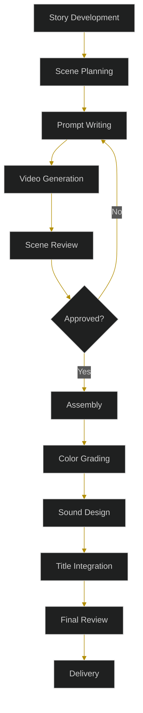

    

<h1 align="center">CODE RED: RETURN OF THE UNDEAD</h1>

    

    

  

 
## 1. Overview

This document provides a full production blueprint for the CODE RED: RETURN OF THE UNDEAD trailer. It covers the storyline, visual direction, scene-by-scene breakdown with video generation prompts, assembly instructions, and post-production finishing. The trailer is a 72-second cinematic piece designed for web and social distribution.

The document is written for a general production team. No prior experience with any specific tool is required. Every prompt is a plain-language visual description that can be used with any video generation system that accepts text descriptions.

### 1.1 Logline

A military contingency plan triggers a catastrophic chain of events. In the ruins that follow, two strangers on a motorcycle navigate a city overrun by the infected and must decide whether survival means trusting another person.

### 1.2 Synopsis

The trailer opens with the scale of a military mobilization. Helicopters, jets, and armored vehicles move with purpose. A distant nuclear detonation over the sea marks the point of no return.

In the aftermath, a city lies half in ruins and half in flames. A rider on a Harley-style motorcycle moves through empty streets, a shotgun strapped across his back. He is searching for a safe route out.

A sudden attack by infected figures forces him to defend himself. The encounter draws the attention of a young woman watching from a cracked window. She steps out of hiding and runs toward him. They lock eyes. She climbs onto the bike behind him.

The streets fill with infected. The two riders cut through the horde and escape. The trailer ends at a riverbank at sunset, where they stand beside the idle motorcycle, exhausted, watching the water. A thin plume of smoke rises in the distance.

### 1.3 Thematic Pillars

| Theme | Description |
|-------|-------------|
| Scale and Isolation | Humanity dwarfed by catastrophe |
| Mechanical Power | Steel as both weapon and sanctuary |
| Human Connection | Trust born from desperation |
| The Inevitable Return | What was buried now rises |

### 1.4 Tonal Arc

The trailer moves from large-scale military action to intimate human vulnerability, then to kinetic survival, and finally to a quiet reckoning. Each 6-second scene functions as a distinct emotional beat within the 72-second sequence. The nuclear detonation is not shown directly. It is referenced only through distant haze and ash light, representing the aftermath rather than the event itself.

 

## 2. Storyline and Characters

### 2.1 Character Profiles

| Character | Description | Visual Identifiers |
|-----------|-------------|-------------------|
| The Rider | South Indian man, late twenties, slim build, long black hair tied back. Wears a dark brown bomber jacket and olive tactical rucksack. A pump-action shotgun is strapped across his back as a prop. | Harley Fat Boy motorcycle, matte black, worn saddle, sunglasses, calm and watchful posture |
| The Woman | Mid-twenties, fair skin, long dark hair. Wears a black hoodie with three white stripes on the left sleeve and grey track pants. Carries a small olive backpack. A compact pistol is visible at her right hip as a prop. | Blue eyes, cautious but determined expression, relieved smile |

### 2.2 Narrative Arc

The trailer follows a non-linear structure. The order of scenes implies a dream-logic flow rather than strict chronology. Scenes 1 and 2 show the pre-outbreak city. Scenes 3 and 4 show the rider scouting. Scene 5 is the first contact. Scene 6 shows the woman watching, a retrospective moment after hearing the shot. Scene 7 is the meeting, immediately after. Scenes 8, 9, and 10 are an extended escape sequence. Scene 11 shows the distant detonation, which occurred earlier in the timeline. Scene 12 is the aftermath, hours later. Editorial must preserve this flow.

 

## 3. Visual Direction

### 3.1 Color Palette

The trailer uses a unified color grade across all scenes. The look is warm and dusty with deep shadows and controlled highlights. The palette is inspired by desert light and firelit ruins.

| Element | Hex Code | Usage |
|---------|----------|-------|
| Highlight | #e6b800 | Sun glints, fire rim light, metal reflections |
| Midtone | #cca300 | Dust, warm surfaces, vehicle bodies |
| Shadow | #1a1a1a | Deep shadows with retained detail |
| Foreground Anchor | #262626 | Silhouettes, foreground rocks, dark clothing |
| Accent | #b38f00 | Dust haze, secondary warm tones |

Saturation is reduced by 10 to 15 percent overall. Blacks are lifted to #1a1a1a to preserve texture. A very subtle cool tint is applied to the deepest shadows to separate metal from dust.

### 3.2 Cinematography Principles

- Camera moves slowly and deliberately. Fast movement is reserved for action moments.
- Low angles emphasize scale and power.
- Partial framing reveals size through what is not shown.
- Foreground objects create parallax and depth.
- Dust, heat haze, and atmospheric particles are present in every outdoor scene.
- Close-up details of treads, rivets, and hands anchor the viewer in the physical world.

### 3.3 Visual Motifs

| Motif | Meaning | Where It Appears |
|-------|---------|------------------|
| Dust | Displacement, aftermath, motion | All land scenes |
| Smoke plumes | Destruction, distance | City overhead, riverbank |
| Silhouette | Isolation, scale | Nuclear cloud, character reveals |
| Chrome and steel | Human engineering against nature | Vehicle close-ups |
| Water | Calm, reflection, survival | Distant detonation, riverbank epilogue |

 

## 4. Scene Breakdown

The trailer runs 72 seconds in total. It is divided into twelve scenes of six seconds each. Each scene is built around one video generation prompt. The prompts are written as plain visual descriptions and do not include technical settings or tool-specific parameters. All videos should be generated at 24 frames per second, 4K resolution, and 16:9 aspect ratio. Use a temperature setting of 0.2 for all generations to ensure consistency.

### 4.1 Scene Overview

| Scene | Title | Timing | Purpose |
|-------|-------|--------|---------|
| 1 | The Contingency | 0:00 to 0:06 | Establish military scale |
| 2 | The Flash | 0:06 to 0:12 | Mark the turning point |
| 3 | The Ruins | 0:12 to 0:18 | Show the aftermath |
| 4 | The Rider | 0:18 to 0:24 | Introduce the protagonist |
| 5 | The Threat | 0:24 to 0:30 | Create tension and action |
| 6 | The Stranger | 0:30 to 0:36 | Introduce the second character |
| 7 | The Alliance | 0:36 to 0:42 | Bring the characters together |
| 8 | The Horde | 0:42 to 0:48 | Escalate the action |
| 9 | The Stand | 0:48 to 0:54 | Show the rider's defiance |
| 10 | The Cover | 0:54 to 1:00 | Show the woman's partnership |
| 11 | The Detonation | 1:00 to 1:06 | Show catastrophic scale |
| 12 | The Riverbank | 1:06 to 1:12 | Provide a quiet aftermath |

 

### Scene 1: The Contingency (0:00 to 0:06)

**Description:** A rapid montage of military hardware in motion. Helicopters in formation against a rising sun. Fighter jets lifting off from a runway. Tanks and armored vehicles rolling across a dusty plain. Quick cuts between each element. Low camera angles emphasize size and power. Dust trails rise behind the vehicles.

**Video Generation Prompt:**
Rapid six-second montage of military hardware in motion: helicopters silhouetted against a rising sun in formation, fighter jets lifting off from a runway in a low-angle shot, tanks and armored vehicles rolling across a dusty plain with dust trails rising behind them, quick cuts between each element, low camera angles emphasizing scale and power, warm amber sunlight breaking through dust, deep shadows, film grain, cinematic realism, no people, no weapons firing, no text.

**Camera Notes:** Low angles only. No eye-level shots. The camera should feel grounded and heavy.

**Audio Notes:** Low diesel rumble, turbine whine, and distant wind. No music. The sound should feel mechanical and inevitable.

 

### Scene 2: The Flash (0:06 to 0:12)

**Description:** A distant nuclear detonation over a calm ocean horizon. A small bright bloom appears on the far horizon. It expands into a towering mushroom cloud with layered condensation rings. A shockwave ripples across the water surface and sends up vertical spray. The cloud billows into an ash-gray sky. The shot holds on a long telephoto perspective to emphasize distance and scale.

**Video Generation Prompt:**
A distant nuclear detonation over a calm ocean horizon, six-second sequence: a small bright bloom appears on the far horizon, expands into a towering mushroom cloud with layered condensation rings, a shockwave ripples across the water surface sending up spray, the cloud billows into an ash-gray sky, long telephoto perspective emphasizing distance and scale, frame shake at the moment of impact, volumetric smoke and steam, warm amber rim light on the cloud edges, crushed shadows, heavy film grain, cinematic realism, no people, no text.

**Camera Notes:** Locked-off telephoto shot. No camera movement except for a subtle frame shake at the moment of detonation.

**Audio Notes:** A deep sub-bass hit at the moment of detonation, followed by a low rumble that decays slowly. No music.

**Content Note:** This scene depicts a fictional event for storytelling. It is not a technical reference.

 

### Scene 3: The Ruins (0:12 to 0:18)

**Description:** A bird's-eye aerial view of a devastated city at dawn. Half the skyline is burning with smoke plumes drifting across collapsed highways. The other half stands in shadow. Overturned vehicles and abandoned cars are visible on the streets. No people are visible. The camera sweeps slowly across the destruction, then cranes down toward street level.

**Video Generation Prompt:**
Bird's-eye aerial view of a devastated city at dawn, six-second sequence: half the skyline is burning with smoke plumes drifting, the other half stands in shadow, collapsed highways and overturned vehicles, empty streets with no people visible, slow telephoto sweep across the destruction, then a gentle crane down toward street level, volumetric haze and drifting ash, amber rim light from fires cutting through gray smoke, high contrast sky, heavy 35mm film grain, cinematic realism, no text.

**Camera Notes:** High altitude establishing shot. The crane down should feel slow and inevitable.

**Audio Notes:** Low ambient sub-rumble, distant creaks, faint wind, and the soft tail of a distant siren.

 

### Scene 4: The Rider (0:18 to 0:24)

**Description:** An aerial follow shot of a South Indian man in his late twenties riding a Harley-style motorcycle through deserted city streets. He has long black hair, wears a dark bomber jacket and tactical rucksack, and has a shotgun strapped across his back as a prop. The camera tracks beside him as he corners and scans alleys. His expression is determined. Debris lines the roads. Burning structures glow in the distance.

**Video Generation Prompt:**
Aerial follow shot of a South Indian man in his late twenties riding a Harley-style motorcycle through deserted city streets, six-second sequence: the rider has long black hair, wears a dark bomber jacket and tactical rucksack, a shotgun is strapped across his back as a prop, mid-range drone tracks beside him as he corners and scans alleys, determined expression, debris-lined roads, burning structures in the distance, low-angle shots emphasizing the machine, dust and smoke in the air, warm amber highlights, crushed shadows, heavy film grain, cinematic realism, no text.

**Camera Notes:** Dynamic drone follow. Occasional low-angle shots to emphasize the motorcycle. The camera should feel like it is chasing the rider, not observing him.

**Audio Notes:** Roaring V-twin engine, gravel scrapes, and the rider's breathing under a helmet.

**Continuity Note:** The shotgun is a visual prop only. It is not fired in this scene.

 

### Scene 5: The Threat (0:24 to 0:30)

**Description:** A tense action sequence in a ruined alley. Rotted figures lunge from a collapsed doorway toward the rider. He raises a shotgun. Cinematic muzzle flash illuminates smoke and dust. Silhouettes collapse into shadowed piles. A slow-motion shell ejection follows. Debris is suspended in air. The sequence is non-graphic and uses silhouettes and motion to convey action.

**Video Generation Prompt:**
A tense six-second action sequence in a ruined alley: rotted figures lunge from a collapsed doorway toward a rider, quick close reaction of his hands raising a shotgun, cinematic muzzle flash illuminating smoke and dust, silhouettes collapsing into shadowed piles, slow-motion shell ejection, debris suspended in air, non-graphic with no visible gore, high-contrast amber highlights and deep shadows, volumetric smoke, heavy film grain, cinematic realism, no text.

**Camera Notes:** Jump cuts and two to three frames of slow motion for impact. The camera should feel handheld and reactive.

**Audio Notes:** Sharp shotgun crack, compressed air blast, heavy thud, and echo. The sound should feel physical and immediate.

**Content Note:** The action is depicted cinematically with silhouettes and implied motion. No explicit gore is shown.

 

### Scene 6: The Stranger (0:30 to 0:36)

**Description:** An intimate reveal. The shot begins on an extreme close-up of striking blue eyes peering through a cracked window. A slow rack-focus pullback reveals a woman in her mid-twenties with long dark hair, fair skin, and a black hoodie with three white stripes. She turns from the window with a small relieved smile. A compact pistol is visible at her hip as a prop. The interior is dim and dust-lit.

**Video Generation Prompt:**
Six-second intimate reveal: extreme close-up on striking blue eyes peering through a cracked window, slow rack-focus pullback to reveal a woman in her mid-twenties with long dark hair, fair skin, wearing a black hoodie with three white stripes and track pants, she turns from the window with a small relieved smile, a compact pistol visible at her hip as a prop, soft backlight, shallow depth of field, dust-lit air, shattered glass, warm amber highlights, crushed shadows, film grain, cinematic realism, no text.

**Camera Notes:** Soft dolly-out. The focus should shift from the eyes to the full face. The camera should feel intimate and quiet.

**Audio Notes:** Faint window creak, quiet breath, and a distant engine rumble.

**Continuity Note:** The pistol is a visual prop only. It is not fired in this scene.

 

### Scene 7: The Alliance (0:36 to 0:42)

**Description:** A kinetic encounter on a deserted road. The woman sprints into frame toward the waiting rider on the Harley. A quick cut to eye contact. She vaults onto the bike behind him and clings shoulder-to-shoulder. The bike accelerates away with dust rising. The camera tracks low and wide. Their expressions show relief.

**Video Generation Prompt:**
Six-second kinetic encounter on a deserted road: a woman sprints into frame toward a waiting rider on a Harley, quick cut to eye contact, she vaults onto the bike behind him and clings shoulder-to-shoulder, low-angle tracking shot as the bike accelerates away with dust rising, relieved expressions, wind catching clothing, motion blur, warm amber sunlight, film grain, cinematic realism, no text.

**Camera Notes:** Handheld roadside perspective for the approach, then dynamic tracking for the takeoff. The camera should feel like it is running alongside the bike.

**Audio Notes:** A sudden uptick in engine roar, fabric rustle, and two quick relieved breaths.

 

### Scene 8: The Horde (0:42 to 0:48)

**Description:** A frantic montage of dozens of shambling infected charging into a street as the motorcycle speeds away. Rapid cuts of lunges and dust. A drone chase over the chaos. Non-graphic with silhouettes and implied motion.

**Video Generation Prompt:**
Six-second frantic montage: dozens of shambling infected charge into a city street as a motorcycle speeds away, rapid cuts of lunges and dust, a drone chase over the chaos, silhouettes and implied motion, non-graphic, warm amber highlights, crushed shadows, heavy film grain, cinematic realism, no text.

**Camera Notes:** Frantic handheld and drone chase. The camera should feel urgent and disoriented.

**Audio Notes:** Staccato gun cracks, crowd roar of infected, high-pass breath sounds, and engine scream.

 

### Scene 9: The Stand (0:48 to 0:54)

**Description:** The rider takes a defensive stand in a narrow alleyway. He fires controlled bursts from an assault rifle. Muzzle flash lights the smoke and dust. Silhouettes of infected surge forward and collapse in shadowed piles. Rapid micro-cuts between his hands, hardened eyes, and the incoming mass. Smoke, sparks, and debris. The sequence is non-graphic.

**Video Generation Prompt:**
Six-second intense firefight cut: a rider takes a defensive stand in a narrow alleyway with an assault rifle, cinematic muzzle flash bursts light the smoke and dust, silhouettes of shambling infected surge forward and collapse in shadowed piles, rapid micro-cuts between his hands, hardened eyes, and the incoming mass, smoke, sparks and debris, non-graphic, warm amber highlights, crushed shadows, heavy film grain, cinematic realism, no text.

**Camera Notes:** Low-angle close intimacy, then quick whip-cuts, then stabilized wide for depth.

**Audio Notes:** Tight cinematic rifle cracks, low sub thuds, gravel hits, and cloth rustle.

**Weapon Continuity Note:** The rider now holds a rifle. Do not show where it came from. Do not depict reloading instructions.

 

### Scene 10: The Cover (0:54 to 1:00)

**Description:** The woman fires controlled bursts from an assault rifle while vaulting onto the Harley seat. She fires through a spray of dust to create a safe corridor as the bike launches forward. Rapid intercuts of her focused gaze, muzzle flashes, tire spray, and collapsing silhouettes. The sequence is non-graphic.

**Video Generation Prompt:**
Six-second dynamic action: a hooded woman fires controlled bursts from an assault rifle while vaulting onto a Harley seat, firing through a spray of dust to create a safe corridor as the bike launches forward, rapid intercuts of her focused gaze, muzzle flashes, tire spray and collapsing silhouettes, non-graphic, cinematic motion blur, warm amber highlights, crushed shadows, heavy film grain, cinematic realism, no text.

**Camera Notes:** Handheld intensity for close fire, follow-tracking for bike motion, brief slow-motion on muzzle flash.

**Audio Notes:** Cinematic rifle cracks, engine surge, and sand or gravel impacts.

**Content Note:** The action is depicted cinematically with silhouettes and implied motion. No explicit gore is shown.

 

### Scene 11: The Detonation (1:00 to 1:06)

**Description:** A distant view of a nuclear detonation over the ocean horizon. The event has already occurred. We see the mushroom cloud at extreme range, already formed, rising into the stratosphere. A small bright bloom expands into a towering cloud with condensation rings. The camera frame shakes slightly. This is an aftermath shot, not an impact shot. No fireball, no shockwave victims, no destruction of recognizable landmarks.

**Video Generation Prompt:**
Six-second cinematic wide: distant horizon over ocean, a sudden brilliant white-orange bloom, fireball expands silently, towering mushroom cloud billows into ash-gray sky, condensation rings form around column, telephoto compression shows scale, camera frame-shake micro-hit, no gore, no destruction detail, warm amber rim highlights, ash midtones, crushed shadows, heavy film grain, cinematic realism, no text.

**Camera Notes:** Wide horizon, slow telephoto push, hold on cloud. No camera movement except for a subtle frame shake.

**Audio Notes:** Absolute silence for two seconds, then a low sub-bass swell, a distant delayed rumble, wind pickup, then cut.

**Content Note:** This is a fictional depiction for storytelling. It is not a technical reference.

 

### Scene 12: The Riverbank (1:06 to 1:12)

**Description:** A quiet riverbank at dusk. The rider and woman stand exhausted beside their idle motorcycle, mud-streaked, gazing across calm water toward low hills and a fading amber sunset. A distant smoke plume rises. The camera pushes in slowly on the two-shot. Their hands almost touch, then pull away. No dialogue.

**Video Generation Prompt:**
Six-second quiet epilogue: dusk at a riverbank, a rider and a woman stand exhausted beside an idle Harley, mud-streaked, gazing across calm water toward low hills and a fading amber sunset, a thin plume of smoke far off, intimate medium-wide two-shot with slow push-in, reflective silence, warm amber sky, film grain, cinematic realism, no text.

**Camera Notes:** Gentle slider or dolly-in with minimal motion. Let ambient sound breathe.

**Audio Notes:** Distant water lap, settling sub-bass, soft wind, and a single insect chirp. No music swell.

**Performance Note:** No dialogue. She looks at him. He looks at the water. She looks forward. His hand moves slightly toward hers, then stops and retreats.

 

## 5. Assembly and Editing

### 5.1 Timeline

| Time | Scene | Transition In | Transition Out |
|------|-------|---------------|----------------|
| 0:00 | The Contingency | Fade from black | Hard cut |
| 0:06 | The Flash | Hard cut | Hard cut |
| 0:12 | The Ruins | Hard cut | Hard cut |
| 0:18 | The Rider | Hard cut | Hard cut |
| 0:24 | The Threat | Hard cut | Hard cut |
| 0:30 | The Stranger | Hard cut | Hard cut |
| 0:36 | The Alliance | Hard cut | Hard cut |
| 0:42 | The Horde | Hard cut | Hard cut |
| 0:48 | The Stand | Hard cut | Hard cut |
| 0:54 | The Cover | Hard cut | Hard cut |
| 1:00 | The Detonation | Hard cut | Hard cut |
| 1:06 | The Riverbank | Hard cut | Fade to black (2s) |

**Total Runtime:** 72 seconds plus 2 seconds of black at the end.

### 5.2 Pacing

- Scenes 1 and 2 are paced to feel inevitable and slow.
- Scenes 3 and 4 build momentum.
- Scene 5 is the first peak of intensity.
- Scene 6 is a deliberate pause for breath.
- Scene 7 rebuilds energy.
- Scenes 8, 9, and 10 maintain high intensity.
- Scene 11 provides a moment of catastrophic scale.
- Scene 12 releases tension with a quiet ending.

### 5.3 Transitions

Use hard cuts between all scenes except the first and last. The fade from black at the start and the fade to black at the end frame the trailer as a complete piece. Do not cut on action. Cut after action completes. Let moments breathe.

### 5.4 Optional Hook Text Slides

Short phrases can be placed on black screens between scenes to add narrative context. These are not required for the trailer to work.

| Slide Position | Text |
|----------------|------|
| After Scene 2 | They called it a contingency plan. |
| After Scene 4 | Steel does not feel fear. Humans do. |
| After Scene 5 | Every second counts. |
| After Scene 7 | What would you fight for? |
| After Scene 12 | The countdown has already begun. |

 

## 6. Post-Production Finishing

### 6.1 Color Grading

Apply a single master look across all scenes. The look is built around warm amber highlights, muted warm midtones, and lifted shadows.

| Parameter | Setting |
|-----------|---------|
| Highlight tint | #e6b800 pushed into highlights only |
| Midtone tint | #cca300 with saturation reduced by 10 to 15 percent |
| Shadow lift | Lift blacks to #1a1a1a, no pure black |
| Shadow accent | Very subtle cool tint in deepest shadows |
| Overall saturation | Reduced by 5 to 12 percent |
| Film grain | 35mm medium, applied as overlay at 30 percent opacity |
| Vignette | Subtle, using #262626, 10 to 15 percent falloff |
| Contrast | Medium-high with filmic roll-off |

### 6.2 Sound Design

The trailer uses four audio layers. These are mixed in post-production.

| Layer | Content | Behavior |
|-------|---------|----------|
| Low Sub | Diesel rumble, ship bass, distant explosions | Present throughout, fades up slightly across the trailer |
| Mid Engine | Rotor chop, turbine whine, truck engines, motorcycle engine | Gated to cuts, rhythmic |
| Transients | Whooshes, gravel impacts, water slaps, metal clanks, gun cracks | One hit on each cut |
| Final Swell | Sub-hit at 1:06, decay to silence at 1:12 | Short and controlled |

Mix note: Duck transient layers under mid-engine layers. Keep low sub present but not muddy. Do not let any single layer dominate.

### 6.3 Title Integration

The trailer does not include burned-in titles or captions in the generated footage. All text is added in post-production.

- Main title: Place the CODE RED: RETURN OF THE UNDEAD logotype over the mushroom cloud in Scene 11, from 1:00 to 1:06. The text fades in over the rising cloud. Use a bold condensed sans-serif font, white, with soft edge falloff. No stroke or drop shadow.
- End card: After the fade to black, display a plain black screen for two seconds, then the text "COMING SOON" in white, then another two seconds of black.
- Optional hook text: Place on black screens between scenes as described in Section 5.4. Use a simple sans-serif font, white, with generous tracking.

### 6.4 Export Settings

| Parameter | Value |
|-----------|-------|
| Resolution | 3840 x 2160 (4K) or 1920 x 1080 (HD) |
| Frame rate | 24 frames per second |
| Aspect ratio | 16:9 |
| Codec | H.264 or H.265 |
| Bitrate | 20 to 40 Mbps for 4K, 10 to 20 Mbps for HD |
| Audio | Stereo, 48 kHz, 16-bit or 24-bit |

 

## 7. Technical Specifications

### 7.1 Generation Parameters

| Parameter | Value |
|-----------|-------|
| Duration per scene | 6 seconds |
| Total runtime | 72 seconds |
| Frame rate | 24 frames per second |
| Resolution | 4K preferred, HD acceptable |
| Aspect ratio | 16:9 |
| Temperature | 0.2 (use this setting for all video generation to ensure consistency) |

### 7.2 Production Workflow

### 7.3 Continuity Checklist

| Item | Detail |
|------|--------|
| Motorcycle | Same Harley-style bike in Scenes 4, 5, 7, 8, 9, 10, and 12. Same matte black paint and worn saddle. |
| Rider's jacket | Dark brown bomber jacket in all scenes where the rider appears. |
| Rider's rucksack | Olive tactical rucksack with consistent shape and color. |
| Woman's hoodie | Black hoodie with three white stripes on the left sleeve. |
| Woman's track pants | Grey track pants. |
| Shotgun | Strapped across the rider's back in Scenes 4 and 5. Not fired in Scene 4. |
| Rifle | Held by the rider in Scene 9 and by the woman in Scene 10. Origin not shown. |
| Pistol | Visible at the woman's hip in Scenes 6 and 7. |
| Lighting direction | Warm amber key rim on characters. Cool shadows. |
| Film grain | Consistent 35mm medium grain across all scenes. |
| Color grade | Same master look applied to all scenes. |

 

## 8. Content Guidelines

### 8.1 Violence

All action in the trailer is depicted cinematically. Violence is conveyed through silhouettes, motion, and implied impact. No explicit gore is shown. The shotgun, rifle, and pistol are visual props. They are not shown being loaded, aimed with technical detail, or used in a way that could be read as instruction.

### 8.2 Safety

The nuclear detonation scene is a fictional depiction for storytelling. It is not a technical reference. No scene in this trailer should be read as a guide to real-world action.

### 8.3 Usage

This document is intended for production teams creating a promotional trailer. The prompts are written to be used with any video generation system that accepts text descriptions. The trailer is suitable for web and social distribution.
 
    
