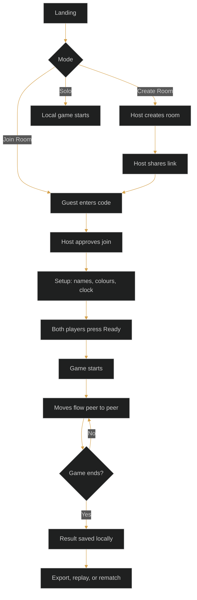
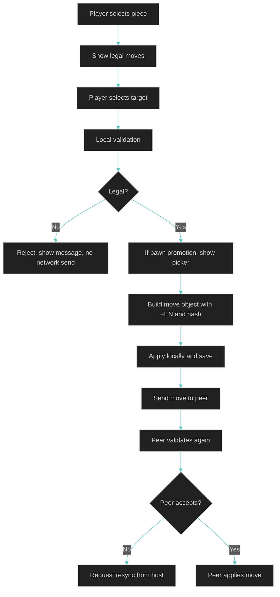
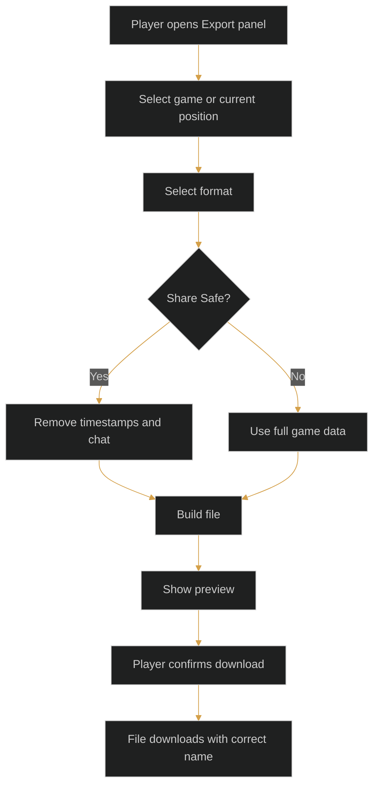
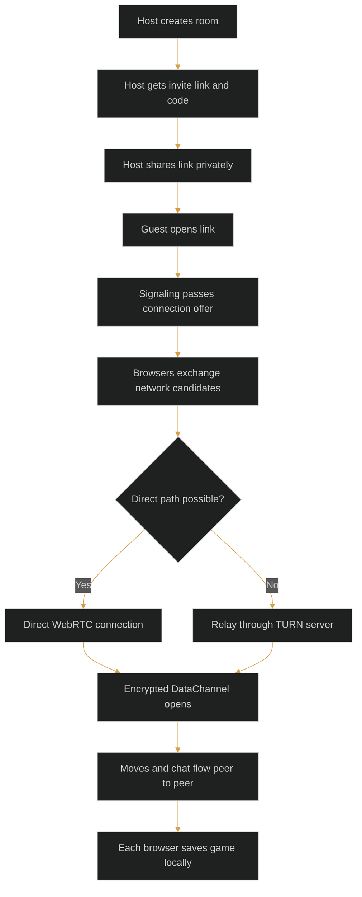
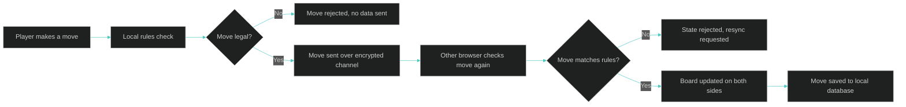

<br><br><br><br>

<h1 align="center">DUALTHRONE CHESS PVP</h1>

<br><br><br><br>

<p align="center">
    <a href="https://github.com/advancedscientificcomputing" target="_blank" rel="noopener noreferrer">
        
    </a>
</p>

<br><br>
 
  
```text
ROLE:
You are a senior full-stack game developer. Build a complete, production-ready,
local-first PvP chess game called DUALTHRONE. Temperature = 0.2. 
Be precise, deterministic, and complete. Do not add Play vs Computer mode.

CORE CONCEPT:
DUALTHRONE is a 2-player-only chess game that runs on local machines.
Both players' machines act as server and client at the same time using
peer-to-peer connection. No central game server controls gameplay.

ARCHITECTURE:
1. P2P NETWORKING:
- Use WebRTC DataChannel for direct peer-to-peer move sync.
- Use a lightweight signaling mechanism only to establish the connection.
- Player 1 = Host / Room Creator. Player 2 = Guest / Joiner.
- Host creates a room and gets a temporary, shareable room URL with a unique Room ID + short join code.
- Room URL expires after game ends or after 60 minutes of inactivity.
- Show connection status: Waiting, Connecting, Connected, Reconnecting, Disconnected.
- Implement automatic reconnection with state resync via FEN + move history hash.
- All moves are validated on BOTH clients before applying. If desync occurs, resync from host's authoritative state.

2. LOBBY & SETUP FLOW:
- Landing screen: [Create Room] / [Join Room] / [Play Solo - Both Sides]
- Create Room: Generate room URL, Copy Link button, Copy Code button, QR code for local network join.
- Join Room: Paste URL or enter Room Code.
- Pre-Game Setup Screen for both players:
  - Player Name input (default: Player 1 / Player 2)
  - Colour Pick: White / Black / Random. If both pick same colour, auto-resolve with coin-flip animation and show result.
  - Time Control Pick: No Clock, Bullet 1+0, Blitz 3+2, Blitz 5+0, Rapid 10+5, Classical 30+0, Custom.
  - Board Theme Pick, Piece Style Pick.
  - Ready button. Game starts only when both players are Ready.
- Solo Mode: One player controls both sides. No network needed. Label clearly as "Solo - Both Sides".

3. CHESS ENGINE - FULL RULES:
Implement complete FIDE rules, not simplified rules:
- All piece movement, capture, check, checkmate, stalemate
- Castling (kingside + queenside, with all legality checks)
- En Passant
- Pawn Promotion with picker UI: Queen, Rook, Bishop, Knight
- Draw by: Stalemate, Threefold Repetition, Fifty-Move Rule, Insufficient Material, Mutual Agreement, Draw Offer
- Resign, Abort, Rematch, Offer Draw, Accept/Decline Draw
- Move validation, illegal move rejection, king safety check
- Check and checkmate detection, pinned piece logic
- SAN notation, FEN generation, PGN generation for every game

4. GAMEPLAY UI & WIDGETS:
- 8x8 board with coordinates (a-h, 1-8), flip board button (auto-flip for Black perspective)
- Click-to-move + Drag-and-drop, tap-to-select on mobile
- Legal move dots, capture rings, last-move highlight, check highlight (red glow on king), selected square highlight, premove indicator
- Promotion picker modal
- Player Cards (Top + Bottom): Avatar initial, Name, Colour dot, Captured pieces with material advantage (+3), Clock, Connection dot
- Move History Panel: Numbered list in SAN, click any move to view that position, auto-scroll to latest, current move highlighted
- Captured Pieces Tray + Material Bar
- Game Status Banner: Turn indicator, Check, Checkmate, Stalemate, Draw, Win/Lose
- Controls: Undo (only in Solo Mode or if opponent agrees in PvP), Resign, Offer Draw, Rematch, New Game, Flip Board, Sound On/Off, Copy FEN, Copy PGN
- Timers: Separate clocks per player, increment support, low-time warning (turns red under 10s), flag fall detection
- Chat Widget: In-room text chat with timestamps, system messages for moves, joins, draw offers
- Sound Widget: Move, capture, check, game start, game end, illegal move. Mute toggle.
- Evaluation Widget (Local Analysis): Show material score, best move hint toggle (optional, local calculation only, not an opponent), blunder/mistake markers in move list after game ends

5. DATABASE & PERSISTENCE:
- Use IndexedDB on each client as local database (Dexie.js or native IndexedDB).
- Store for every game: Game ID, Room ID, Player names, Colours, Time Control, Start Time, End Time, Result, Reason, Full Move List with SAN + FEN per move + timestamps + time remaining per move, Chat log, Final FEN, PGN.
- Auto-save after every move. On refresh/reconnect, restore game.
- Game History Library: Searchable list of past games, filter by player, result, date. Click to replay game move-by-move with Play/Pause/Next/Prev/Slider.
- Analysis View: After game, show move accuracy, captures timeline, material graph, key moments (check, checkmate, blunders).

6. EXPORT OPTIONS:
Add an Export Panel with one-click download for the selected game:
- PNG: Board image of current position or final position, 1080x1080, with player names + result header
- JPG: Same as PNG in JPG format
- TXT: Plain move list + result + players
- MD: Markdown game report with header, players, result, move list table, FEN
- PDF: Professional game sheet with board diagram, players, result, full move list, analysis summary
- PGN: Standard PGN file for Chess.com / Lichess / ChessBase import
- FEN: Copy current FEN string
- JSON: Full raw game data for developers
- CSV: Move-by-move data (move number, player, SAN, FEN, time left, captured piece)
Export must work offline and include correct filenames: DUALTHRONE_GameID_Date.Format

7. DESIGN SYSTEM:
- Name: DUALTHRONE
- Theme 1 Default: Obsidian & Sovereign Gold - BG #0B0B10, Panel #16161F, Light Square #EDE0C8, Dark Square #7A5A3A, Accent #D4A04A, Text #F2EFE9
- Theme 2: Midnight Teal - BG #07131A, Panel #0E2530, Light #DDE8E6, Dark #2F6B6B, Accent #4CC9C0
- Typography: Display font for title, clean sans for UI, monospace for move list
- Layout: Desktop = Board left, Sidebar right (Players + Moves + Chat). Mobile = Stacked, responsive, touch-friendly, min 320px width
- No emojis in UI. Use SVG icons and Unicode chess glyphs only.

8. TECH STACK:
- Single-file-first approach if possible, otherwise: HTML + CSS + Vanilla JS or React + Vite
- Use chess.js for rules validation OR write custom engine with full rules. Do not use simplified engine.
- Use PeerJS or native WebRTC for P2P. Use html2canvas + jsPDF for PNG/JPG/PDF export.
- No backend required for gameplay. No login required. No ads. No Play vs Computer.

9. EDGE CASES & QUALITY:
- Handle disconnect mid-game: Pause clock, show reconnect overlay for 60 seconds, allow resume.
- Handle both players picking same colour, invalid room code, expired link, illegal move spam.
- Handle promotion, draw offers, resign during opponent turn.
- Keyboard shortcuts: U = Undo (Solo), F = Flip Board, R = Rematch prompt, Esc = Deselect.
- Accessibility: ARIA labels, keyboard navigation, high contrast mode.

10. DELIVERABLE:
- Deliver complete working code in one project.
- Include: index.html, style.css, app.js OR single HTML file.
- Include README with: How to run locally, How to create room, How to join on same WiFi / LAN, How to export, How to replay.
- Test checklist: Create room, join, pick colours, play full game with castling + en passant + promotion, resign, draw, rematch, export all formats, replay from history.

CONSTRAINT: Do not add AI opponent. DUALTHRONE is PvP only or Solo Both-Sides.
```

<br><br>

<h1 align="center">DUALTHRONE DEVELOPMENT GUIDE</h1>

<br>

## 1. Purpose Of This Guide

This guide explains how to build, run, test, and maintain DUALTHRONE from start to finish.

DUALTHRONE is a two player chess game. It runs in the browser. There is no central game server. There is no computer opponent. A player can play against another player over a direct connection, or play alone and control both sides.

Use this guide as the single source of truth for development. If a decision is not covered here, follow the rule in Section 2.

<br>

## 2. Core Rules For Development

1. Two players only. No computer opponent.
2. Both browsers validate every move. Never trust a move from the network without checking it.
3. Game data stays on the player's machine unless the player exports it.
4. The game must work offline after the page loads, except for the connection setup.
5. Keep the interface simple. Use clear labels. Use no emojis in the interface.
6. Keep code deterministic. The same moves must produce the same position on both machines.
7. Keep all changes small and testable. One feature at a time.

<br>

## 3. Product Overview

### 3.1 Modes

| Mode | How it works | Network needed |
| --- | --- | --- |
| Create Room | Player 1 creates a room and shares a link | Yes, for setup and play |
| Join Room | Player 2 opens the link and joins | Yes, for setup and play |
| Solo, Both Sides | One player controls White and Black | No |

### 3.2 Main screens

| Screen | Purpose |
| --- | --- |
| Landing | Choose Create Room, Join Room, or Solo |
| Room Lobby | Share link, copy code, wait for guest, approve join |
| Setup | Enter names, pick colours, pick time control, pick board theme, press Ready |
| Game | Board, clocks, move list, captured pieces, chat, controls |
| History | List of past games, search, filter, replay |
| Analysis | Move accuracy, material graph, key moments |
| Export | Download game in one or more formats |

### 3.3 Game flow



<br>

## 4. Design System

### 4.1 Themes

| Theme | Background | Panel | Light square | Dark square | Accent | Text |
| --- | --- | --- | --- | --- | --- | --- |
| Obsidian and Sovereign Gold, default | #0B0B10 | #16161F | #EDE0C8 | #7A5A3A | #D4A04A | #F2EFE9 |
| Midnight Teal | #07131A | #0E2530 | #DDE8E6 | #2F6B6B | #4CC9C0 | #F2EFE9 |

### 4.2 Typography and layout

| Element | Rule |
| --- | --- |
| Title | Display font, large, high contrast |
| Interface text | Clean sans serif |
| Move list and FEN | Monospace |
| Desktop layout | Board on left, sidebar on right with players, moves, chat |
| Mobile layout | Stacked, touch friendly, minimum width 320px |
| Icons | SVG icons and Unicode chess glyphs only |

### 4.3 Board states

| State | Visual rule |
| --- | --- |
| Selected square | Clear outline in accent colour |
| Legal move | Small dot in empty square |
| Legal capture | Ring around target square |
| Last move | Soft highlight on from and to squares |
| King in check | Red glow on king square |
| Premove | Faint marker, applied when turn arrives |

<br>

## 5. Technology Choices

### 5.1 Recommended stack

| Layer | Choice | Why |
| --- | --- | --- |
| Interface | HTML, CSS, Vanilla JS, or React with Vite | Small bundle, easy to maintain |
| Chess rules | chess.js, or a custom engine with full rules | Proven move validation, SAN, FEN, PGN |
| Peer connection | Native WebRTC DataChannel | Encrypted, direct, no game server |
| Signaling | Small self hosted WebSocket service | Only used to start the connection |
| Local database | IndexedDB, with Dexie.js wrapper if needed | Stores games offline |
| Image export | Canvas rendering | PNG and JPG from board state |
| PDF export | jsPDF | Game sheet with board diagram and moves |
| QR code | Small QR library | Local network join |

### 5.2 What not to use

| Avoid | Reason |
| --- | --- |
| Central game server for moves | Breaks the peer to peer design |
| Unencrypted channel | WebRTC DataChannel is encrypted by default, keep it that way |
| Login or accounts | Not required, adds risk and friction |
| Ads or trackers | Not required, adds privacy risk |

### 5.3 Project structure

```text
dualthrone/
  index.html
  css/
    style.css
    themes.css
  js/
    main.js
    chess-engine.js
    board.js
    clock.js
    network.js
    signaling.js
    storage.js
    export.js
    chat.js
    analysis.js
  assets/
    pieces/
    sounds/
  server/
    signaling.js
  README.md
  SECURITY.md
```

For a single file build, keep the same logical sections in one HTML file with clear comment headers.

<br>

## 6. Development Setup

### 6.1 Requirements

| Tool | Version |
| --- | --- |
| Node.js | 18 or later |
| Modern browser | Chrome, Edge, Firefox, or Safari, latest stable |
| Code editor | Any editor with HTML, CSS, and JS support |

### 6.2 Local setup steps

1. Clone or copy the project folder.
2. Open a terminal in the project folder.
3. Run `npm install` if a package file is present.
4. Start the signaling server with `node server/signaling.js`.
5. Start the static server with `npx serve .` or `npm run dev`.
6. Open `http://localhost:3000` in two browser windows or two machines.
7. In window 1, press Create Room. Copy the link.
8. In window 2, open the link. Approve the join in window 1.
9. Complete setup and press Ready in both windows.

### 6.3 Same WiFi testing

1. Find the host machine local IP, for example `192.168.1.20`.
2. Start the servers on the host.
3. On the second machine, open `http://192.168.1.20:3000`.
4. Create and join the room as above.
5. If the browser blocks camera or network access, use `http://` on local network only for testing, and `https://` for public use.

### 6.4 Environment settings

| Setting | Local development | Production |
| --- | --- | --- |
| Signaling URL | ws://localhost:8080 | wss://signaling.yourdomain.com |
| STUN server | Self hosted or none | Self hosted |
| TURN server | Optional for local test | Required for Private Mode |
| Log level | Debug | Error only, no SDP logs |
| Log retention | Session only | Stated in privacy notice |

<br>

## 7. Chess Engine

### 7.1 Rules to implement

All rules must follow FIDE rules. Do not use a simplified engine.

| Rule | Notes |
| --- | --- |
| Piece movement | King, Queen, Rook, Bishop, Knight, Pawn |
| Capture | Normal capture, en passant |
| Castling | Kingside and queenside, check all legality conditions |
| Promotion | Queen, Rook, Bishop, Knight, with picker |
| Check | Detect check after every move |
| Checkmate | No legal moves and king in check |
| Stalemate | No legal moves and king not in check |
| Threefold repetition | Same position three times, same side to move, same castling and en passant rights |
| Fifty move rule | Fifty moves by each side without pawn move or capture |
| Insufficient material | King vs king, king and minor piece vs king, and similar cases |
| Draw by agreement | Offer, accept, decline |
| Resign and abort | End game with clear reason |
| Pinned pieces | A pinned piece cannot move if it exposes the king |

### 7.2 Data for each move

Store this data for every move. It is used for validation, replay, analysis, and export.

| Field | Example | Purpose |
| --- | --- | --- |
| Move number | 12 | Ordering |
| Player | White | Turn |
| SAN | Nf3 | Display and PGN |
| From square | g1 | Replay |
| To square | f3 | Replay |
| Piece | N | Analysis |
| Captured piece | None or p | Material |
| FEN after move | rnbqkbnr/pppppppp/8/8/8/5N2/pppppppp/RNBQKB1R b KQkq - 1 1 | Position restore |
| Clock after move | 295 seconds | Clock display |
| Timestamp | 2026-11-22T10:00:00Z | History |
| Previous hash | a1b2c3 | Integrity chain |

### 7.3 Move validation flow



### 7.4 Draw and end conditions

| End condition | Result | Reason code |
| --- | --- | --- |
| Checkmate | Win for mating side | CHECKMATE |
| Stalemate | Draw | STALEMATE |
| Threefold repetition | Draw, on claim or auto | REPETITION |
| Fifty move rule | Draw | FIFTY_MOVE |
| Insufficient material | Draw | INSUFFICIENT_MATERIAL |
| Draw agreement | Draw | AGREEMENT |
| Resign | Win for other side | RESIGN |
| Flag fall, opponent has mating material | Win for other side | TIME |
| Flag fall, opponent has no mating material | Draw | TIME_INSUFFICIENT |
| Abort, before move 2 | No result | ABORT |

<br>

## 8. Networking

### 8.1 Connection modes

| Mode | IP visibility | Speed | When to use |
| --- | --- | --- | --- |
| Direct Mode | Each player sees the other IP | Fastest | Play with a trusted friend |
| Private Mode | Each player sees only relay IP | Slower, depends on relay | Play with a stranger |

Show both modes on the Create Room screen. Explain the difference in one line each. Do not hide the IP sharing behavior of Direct Mode.

### 8.2 Signaling

Signaling is only used to exchange connection offers. It does not carry game moves.

Steps:
1. Host creates room. Signaling server stores room ID and code.
2. Guest joins with code. Signaling server forwards the offer.
3. Browsers exchange ICE candidates through signaling.
4. DataChannel opens. Signaling is no longer needed for the game.
5. Room is closed after game ends or after 60 minutes idle.

Rules:
- Room code must be at least 8 characters, letters and numbers, from a secure random generator.
- Optional room password, set by host.
- Host approval required before guest can enter setup.
- Max 2 players per room. Reject third join.
- After 5 failed join attempts, lock room for 5 minutes.
- Keep no logs, or state log retention clearly.

### 8.3 Message protocol

Use JSON messages with a fixed shape. Reject any message that does not match.

| Type | Fields | Direction |
| --- | --- | --- |
| hello | roomId, playerName, version | Both |
| setup | colourChoice, timeControl, theme | Both |
| ready | ready true or false | Both |
| move | san, from, to, promotion, fen, prevHash, hash, clock | Sender to receiver |
| chat | text, timestamp | Sender to receiver |
| drawOffer | offerId | Sender to receiver |
| drawResponse | offerId, accepted | Receiver to sender |
| resign | reason | Sender to receiver |
| rematchOffer | offerId | Sender to receiver |
| rematchResponse | offerId, accepted | Receiver to sender |
| resyncRequest | lastMoveNumber | Either |
| resyncResponse | fullHistoryHash, fen, moveList | Host to guest |
| ping | timestamp | Either |
| error | code, message | Either |

Rules:
- Ignore unknown message types.
- Limit message size to 64 KB.
- Limit chat to 500 characters and 1 message per second.
- Validate every move message before applying it.

### 8.4 Reconnection

1. On disconnect, pause both clocks.
2. Show reconnect overlay with a 60 second timer.
3. Try to reconnect automatically up to 3 times.
4. On reconnect, compare move history hash.
5. If hashes match, resume.
6. If hashes differ, request resync from host. Host sends full history and current FEN. Guest validates each move in order, then resumes.
7. If reconnect fails, offer Save and Exit. Game stays in local history for later replay.

### 8.5 Clock handling

| Rule | Detail |
| --- | --- |
| Clock owner | Each browser runs its own clock display, but move messages carry clock values for verification |
| Increment | Add increment after the move is completed |
| Low time | Under 10 seconds, clock turns red and sound warning plays once |
| Flag fall | Player with no time left loses, unless opponent has insufficient material, then draw |
| Pause | Clock pauses on disconnect, on draw offer dialog, and on promotion picker if configured |

<br>

## 9. Interface Implementation

### 9.1 Board

- Render 8 by 8 grid.
- Show coordinates a to h and 1 to 8.
- Support click to move and drag and drop.
- Support tap to select on mobile.
- Auto flip board for Black perspective, with manual Flip button.
- Keyboard support: arrow keys to move selection, Enter to select, Esc to deselect.

### 9.2 Player cards

Each player card shows:
- Initial avatar
- Display name
- Colour dot
- Clock
- Captured pieces
- Material advantage, for example +3
- Connection status dot

### 9.3 Move history

- Numbered list in SAN.
- Click a move to view that position.
- Highlight current move.
- Auto scroll to latest move.
- Show capture marker, check marker, checkmate marker.

### 9.4 Controls

| Control | Behavior |
| --- | --- |
| Undo | Solo mode only, or in PvP only if opponent accepts undo request |
| Resign | Confirm dialog, then end game |
| Offer Draw | Send offer, wait for response, timeout after 30 seconds |
| Rematch | Swap colours by default, or keep colours if both agree |
| New Game | Return to setup, keep names |
| Flip Board | Change perspective |
| Sound | Toggle all sounds |
| Copy FEN | Copy current FEN to clipboard |
| Copy PGN | Copy full PGN to clipboard |

### 9.5 Chat

- Plain text only. No HTML rendering.
- Show timestamp and sender name.
- Show system messages for join, leave, draw offer, resign, rematch.
- Mute and clear options.

### 9.6 Sounds

| Event | Sound |
| --- | --- |
| Move | Short click |
| Capture | Deeper click |
| Check | Alert tone |
| Game start | Short chime |
| Game end | Longer chime |
| Illegal move | Low buzz |
| Low time | Tick |

Provide a mute toggle. Store the setting locally.

<br>

## 10. Storage

### 10.1 What to store

| Table | Fields |
| --- | --- |
| Games | gameId, roomId, playerWhite, playerBlack, timeControl, startTime, endTime, result, reason, finalFen, pgn |
| Moves | gameId, moveNumber, san, from, to, piece, captured, fen, clock, timestamp, hash |
| Chat | gameId, sender, text, timestamp |
| Settings | theme, pieceStyle, sound, boardFlip, displayName |

### 10.2 What not to store

Do not store IP addresses, device details, precise location, or browser fingerprint data. This keeps exports and local data clean.

### 10.3 Storage functions

| Function | Purpose |
| --- | --- |
| saveGame | Create game record |
| saveMove | Append move and update game |
| loadGame | Load game by ID |
| listGames | List with search and filter |
| deleteGame | Delete one game |
| clearAll | Delete all games and chat |
| exportGame | Build export payload for one game |

Auto save after every move. On page reload, offer to restore the last active game.

<br>

## 11. Export

### 11.1 Export formats

| Format | Content | Size and notes |
| --- | --- | --- |
| PNG | Board image 1080 by 1080, names and result header | Current or final position |
| JPG | Same as PNG | Smaller file, for sharing |
| TXT | Plain move list, players, result | Simple, readable anywhere |
| MD | Markdown report, players, result, move table, FEN | For docs and websites |
| PDF | Game sheet, board diagram, players, result, moves, analysis summary | For printing |
| PGN | Standard PGN | Import to Chess.com, Lichess, ChessBase |
| FEN | Current FEN string | Copy to clipboard |
| JSON | Full raw game data | For developers |
| CSV | Move by move data, number, player, SAN, FEN, clock, captured | For spreadsheets |

### 11.2 Export rules

- File name format: `DUALTHRONE_GameID_Date.Format`
- Example: `DUALTHRONE_G123_2026-11-22.pgn`
- Export works offline.
- Show a preview before download.
- Offer Share Safe Export. This version removes timestamps and chat.
- Do not include IP, device, or location data in any export.

### 11.3 Export flow



<br>

## 12. Analysis View

After a game ends, show:
- Result and reason
- Material graph over time
- Captures timeline
- Key moments: checks, checkmates, large material swings
- Move accuracy, simple local calculation, no computer opponent
- Blunder and mistake markers in the move list

Analysis is local only. It does not play moves for the player during a game unless the player turns on Hint mode in Solo mode. In PvP mode, hints must be off by default to keep the game fair.

<br>

## 13. Security Implementation

This section is a short build checklist. Full details are in the security report.

| Control | Implementation note |
| --- | --- |
| Room code | At least 8 chars, crypto random |
| Room password | Optional, hashed, never sent in plain log |
| Host approval | Guest waits until host accepts |
| Private Mode | Force TURN relay, no direct candidates |
| Direct Mode consent | Show clear text before connection |
| Move validation | Both sides, full rules |
| Hash chain | Hash of previous FEN plus move plus timestamp |
| No logs | No SDP logs in production |
| Export sanitization | No IP, device, location |
| Chat safety | Plain text, length limit, rate limit |
| Delete controls | Delete game, chat, all history |

## 14. Accessibility

| Requirement | Detail |
| --- | --- |
| Keyboard | Full game playable with keyboard |
| ARIA labels | Board, squares, buttons, clocks |
| Focus | Visible focus outline |
| Contrast | High contrast mode toggle |
| Text size | Interface scales to 200 percent without break |
| Motion | Reduce motion option, no auto play animation |

<br>

## 15. Testing

### 15.1 Unit tests

| Area | Tests |
| --- | --- |
| Chess rules | Legal moves for each piece, castling, en passant, promotion, check, checkmate, stalemate |
| Draw rules | Repetition, fifty move, insufficient material |
| FEN and PGN | Generate and parse, round trip test |
| Clock | Increment, flag fall, pause on disconnect |
| Validation | Reject illegal moves, reject malformed messages |
| Hash chain | Tampered history breaks chain |

### 15.2 Integration tests

| Test | Steps |
| --- | --- |
| Create and join | Host creates, guest joins, both see setup |
| Colour conflict | Both pick White, coin flip resolves, both see same result |
| Full game | Play 20 moves, check both boards match |
| Castling | Play kingside and queenside castling, check FEN |
| En passant | Set up position, play en passant, check capture |
| Promotion | Promote to Queen and Knight, check picker and board |
| Disconnect | Disconnect mid game, reconnect, resume with same position |
| Draw offer | Offer, accept, game ends as draw |
| Resign | Resign, result saved, history updated |
| Rematch | Rematch, colours swap, new game starts |
| Export | Export all formats, check file names and content |

### 15.3 Manual test checklist

1. Create room, join, pick colours, play full game.
2. Test on desktop and mobile.
3. Test on two different networks.
4. Test Direct Mode and Private Mode.
5. Test Solo mode.
6. Test export for each format.
7. Test replay from history with slider.
8. Test accessibility with keyboard only.

### 15.4 Test positions

Use these FEN positions in tests:

| Test | FEN |
| --- | --- |
| Start | rnbqkbnr/pppppppp/8/8/8/8/PPPPPPPP/RNBQKBNR w KQkq - 0 1 |
| En passant ready | rnbqkbnr/ppp1pppp/8/3pP3/8/8/PPPP1PPP/RNBQKBNR w KQkq d6 0 2 |
| Castling rights | r3k2r/pppppppp/8/8/8/8/PPPPPPPP/R3K2R w KQkq - 0 1 |
| Promotion | 8/P7/8/8/8/8/8/4K2k w - - 0 1 |

<br>

## 16. Deployment

### 16.1 Deployment steps

1. Build the static files.
2. Deploy static files to hosting with HTTPS.
3. Deploy signaling server with WSS.
4. Deploy TURN server for Private Mode.
5. Set environment variables for signaling URL, STUN, TURN, and log level.
6. Test Create Room and Join Room on two machines on different networks.
7. Test export and history.
8. Publish privacy notice and security summary.

### 16.2 Pre release checklist

| Item | Pass |
| --- | --- |
| HTTPS enabled | Yes or No |
| WSS enabled for signaling | Yes or No |
| No console logs with SDP or IP | Yes or No |
| Room code, password, host approval work | Yes or No |
| Private Mode hides IP | Yes or No |
| All exports have correct names | Yes or No |
| History and replay work | Yes or No |
| Accessibility check passes | Yes or No |
| Privacy notice published | Yes or No |

### 16.3 Post release

- Monitor signaling server uptime and error rate.
- Monitor TURN server bandwidth.
- Keep a changelog. List each release with date and changes.
- Keep a simple bug report page. Ask for browser, mode, and steps to reproduce. Do not ask for IP or personal data.

<br>

## 17. Maintenance

| Task | Frequency |
| --- | --- |
| Update dependencies | Monthly |
| Review signaling logs policy | Quarterly |
| Test on new browser versions | On each major browser release |
| Review security controls | Quarterly |
| Backup documentation | On each release |

## 18. FAQ For Developers

**Can we add a computer opponent later?**
No. The product rule is PvP only or Solo Both Sides. A hint mode in Solo mode is allowed, but it must not play as an opponent.

**Can we add spectators?**
Only if the host allows it, and only with a separate spectator link. Spectators must not be able to send moves or chat unless the host allows chat.

**Can we store games on a server?**
Only if the player opts in. Default must stay local. If server storage is added later, it needs its own privacy notice and consent screen.

**What if the two browsers disagree on the position?**
Request resync. Validate the host history move by move. If validation fails, stop the game and show an error. Do not guess a position.

**What if a player closes the tab?**
Save the game locally. On return, offer to resume if the room is still valid, or to view the game in history.

<br>

## 19. Appendix


### 19.1 File naming

| File | Pattern |
| --- | --- |
| Export | DUALTHRONE_GameID_Date.Format |
| Screenshot | DUALTHRONE_Board_GameID_Date.png |
| Log, local only | dualthrone-debug-YYYY-MM-DD.txt |

### 19.2 Versioning

Use semantic versioning: Major.Minor.Patch. Example: 1.0.0. Increase Major for breaking changes, Minor for new features, Patch for fixes.

### 19.3 Glossary

| Term | Meaning |
| --- | --- |
| FEN | Forsyth Edwards Notation, a single line that describes a board position |
| SAN | Standard Algebraic Notation, a short form for a move, for example Nf3 |
| PGN | Portable Game Notation, a standard file for full games |
| ICE | Interactive Connectivity Establishment, the method WebRTC uses to find a network path |
| STUN | Server that tells a browser its public IP |
| TURN | Server that relays traffic when a direct path fails |
| DataChannel | Encrypted channel in WebRTC for game data |

<br><br>

<h1 align="center">DUALTHRONE SECURITY REPORT</h1>

<br>

## 1. Overview

DUALTHRONE is a chess game for two human players. It runs in the browser on each player's own machine. There is no central game server. There is no computer opponent. A player can also play alone and control both sides.

The two browsers connect directly to each other with WebRTC. A small signaling step helps the two browsers find each other. After the connection is made, moves, chat messages, clocks, and game results travel directly between the two players.

This design has a clear benefit. No outside company needs to store the game. It also has a clear cost. Each player must trust the other player more than in a normal server based game, because there is no neutral referee in the middle.

This report describes what is protected, what is exposed, and what must change before the game is used with people who do not know each other.

<br>

## 2. How The System Works

### 2.1 Main parts

| Part | What it does | Where it lives |
| --- | --- | --- |
| Host browser | Creates the room, sends the invite link, keeps a copy of the game | Player 1 machine |
| Guest browser | Joins with the link or code, keeps a copy of the game | Player 2 machine |
| Signaling service | Passes connection offers between the two browsers | Small server, used only at start |
| STUN or TURN server | Helps the browsers find a network path, or relays traffic if a direct path fails | Network helper server |
| Local database | Stores past games, moves, chat, and exports | Browser IndexedDB on each machine |
| Export tools | Create PNG, JPG, TXT, MD, PDF, PGN, FEN, JSON, and CSV files | Browser, works offline |

### 2.2 Connection flow



### 2.3 Move flow



<br>

## 3. Threat Model

This section states who we protect against, and who we do not protect against. A security report is only useful if these limits are clear.

### 3.1 Who is in scope

| Actor | Concern |
| --- | --- |
| The other player | Can see network data, can try to cheat, can try to learn personal details |
| A stranger with the invite link | Can try to join a room that is not theirs |
| A person on the same WiFi or network | Can try to listen to traffic |
| A public signaling or STUN operator | Can see connection metadata |
| A person who receives an exported file | Can read what is inside that file |

### 3.2 Who is out of scope

| Actor | Reason |
| --- | --- |
| A person with physical access to a player's machine | Physical access breaks most browser security controls |
| A person who installs malware on a player's machine | Malware is outside the control of a web game |
| A state level attacker with full network control | This game is not built for that level of threat |

### 3.3 What the game must protect

1. Game integrity. Moves must follow chess rules. History must not be changed without detection.
2. Room access. Only the invited player should enter the room.
3. Network privacy. Strangers should not learn a player's IP address unless the player accepts that risk.
4. Local data. Past games should stay on the player's machine unless the player exports them.
5. Export safety. Exported files should contain only game data, not device or network details.

<br>

## 4. Findings

Findings are rated by impact and by how likely they are in normal use.

| ID | Finding | Severity | Likelihood in casual play |
| --- | --- | --- | --- |
| F01 | Opponent learns public IP address in direct mode | High | High, by design |
| F02 | Room access relies on link only | Medium | Medium, if link is shared widely |
| F03 | No neutral referee, clients trust each other | High | Low with friends, high with strangers |
| F04 | Signaling and STUN servers see connection metadata | Medium | High if public servers are used |
| F05 | Exported files can include real names and timestamps | Low | Medium, depends on player input |
| F06 | Chat and game data are visible to the other endpoint | Medium | Always, by design |
| F07 | No rate limit or lockout on join attempts | Medium | Low, unless room code is short |
| F08 | Clock and result can be disputed | Low | Low with friends, higher in competitive play |

<br>

## 5. Detailed Analysis

### 5.1 IP address exposure in direct mode

WebRTC needs a network path between two browsers. To build that path, the browsers exchange ICE candidates. Those candidates include IP addresses.

In direct mode, the other player receives the public IP address of the first player. This is not a bug. It is how direct peer to peer networking works. A player can view this address in browser diagnostic tools or with a packet capture tool.

An IP address alone does not reveal a home address, a name, or files on the machine. It can reveal an approximate city, an internet provider, and a network identifier. It can also be used to attempt network flooding.

Mitigation:
- Offer a Private Mode that forces traffic through a TURN relay. In that mode, each player sees only the relay IP.
- Recommend a VPN for play with strangers. A VPN hides the real IP behind the VPN exit IP.
- Make the default choice clear in the interface. Show Direct Mode and Private Mode as separate options, with a short explanation of the difference.
- Do not hide this behavior. Players should consent to IP sharing before the connection starts.

### 5.2 Room access and invite links

A room is created with a temporary URL and a join code. If the code is short and there is no password, anyone who guesses the code or receives a forwarded link can join.

The risk increases when a link is posted in a public chat, a stream, or a social post. The link can be copied and forwarded without the host knowing.

Mitigation:
- Use a room code of at least 8 characters, with letters and numbers, generated with a secure random generator.
- Add an optional room password set by the host.
- Require host approval before a guest can enter the game. Show the guest name or code, and let the host accept or reject.
- Allow only two players per room. Reject a third join attempt.
- Expire the room after the game ends or after 60 minutes without activity.
- Allow the host to revoke the link at any time.
- Limit join attempts. After 5 failed attempts, lock the room for 5 minutes.

### 5.3 Game integrity without a server

Both browsers check each move. There is no independent server to decide who is right if the two copies disagree.

A modified browser could:
- Send an illegal move and hope the other side does not check it strictly
- Send a false clock value
- Claim a win, a draw, or a resign that did not happen
- Change local history after the game

The current design reduces this risk by checking moves on both sides and by resyncing from the host state when a mismatch is found. It does not remove the risk.

Mitigation:
- Validate every incoming move against the full chess rules, including castling rights, en passant, check, and pinned pieces. Reject any move that fails.
- Keep a chain of states. For each move, store the previous FEN, the move in SAN, a timestamp, and a hash of those values. If history is changed, the hash chain breaks.
- Treat the host state as the tie breaker only after both sides have validated it. Do not accept a host state that contains an illegal move.
- For casual play, this is enough. For ranked play, prizes, or money, do not use peer to peer alone. Use a server to record moves and decide results.

### 5.4 Signaling, STUN, and TURN servers

The signaling server only helps the two browsers meet. It does not need to see the game. But a public signaling server can see room IDs, connection times, and IP addresses in the connection offers.

A STUN server also sees the IP address when a browser asks for its public address.

Mitigation:
- Self host the signaling server when possible. For play on the same local network, run signaling on the local network.
- Keep no logs on the signaling server. If logs are needed for debugging, keep them for a short period and state that period in the privacy notice.
- Use a self hosted STUN server, or use TURN only mode, so a public STUN provider is not involved.
- Choose a TURN provider with a clear privacy policy. The TURN server will relay traffic and can see metadata such as timing and volume, but it cannot read the encrypted game data.

### 5.5 Encryption in transit

WebRTC DataChannel uses DTLS encryption. This means a person on the same WiFi cannot read moves or chat in plain text by listening to the network.

Encryption protects traffic from outsiders. It does not protect data from the other player. The other player is an endpoint of the encrypted channel, so they can read everything the game sends to them. That includes moves, chat, names, and time controls.

Mitigation:
- Keep DTLS enabled. Do not offer an unencrypted mode.
- Do not send more data than needed. Send only the move, the clock, and the chat message. Do not send device details, local file paths, or other games.
- Warn players that chat is visible to the other player and is stored in both local databases.

### 5.6 Local storage

Past games are stored in IndexedDB in each browser. This data stays on the player's machine. It is not uploaded to a central server by the game.

IndexedDB is protected by the browser origin. Another website cannot read it. A person with access to the unlocked machine or browser profile could read it.

Mitigation:
- Store only game data. Do not store IP addresses, device details, or location in the local database.
- Allow the player to delete a game, delete chat, or clear all history from the settings page.
- Show what is stored. Provide a simple data view that lists games and their size.

### 5.7 Exports

Exports are created in the browser and downloaded by the player. Exports contain player names, results, moves, and timestamps. They do not contain IP addresses in the current design.

The risk is social, not technical. If a player uses a real name, that name will appear in every exported PGN, PDF, MD, JSON, and CSV file. If the player then shares that file, the name travels with it.

Mitigation:
- Use display names only. Do not add real names, emails, IPs, or device details to exports.
- Offer an export option to remove timestamps and chat. Label it as Share Safe Export.
- Show a preview of what will be included before download.
- Use file names that contain only the game ID and date, not player names, unless the player chooses to include them.

### 5.8 Chat

Chat is part of the room. Messages are sent to the other player and stored on both machines. There is no moderation server.

Mitigation:
- Limit message length and message rate to prevent spam.
- Allow block and mute. Allow either player to leave the room at any time.
- Allow the host to clear chat for both sides before export.
- Do not allow links to run code. Render chat as plain text, not as HTML.

### 5.9 Denial of service and flooding

Because the opponent learns the IP in direct mode, a hostile opponent could attempt to flood that IP. This is uncommon in friendly play, but it is possible.

Mitigation:
- Use Private Mode with a TURN relay for play with strangers.
- Use a VPN for extra protection.
- Allow the player to close the room and stop the connection quickly from the interface.
- Limit the rate of incoming messages. Drop messages that do not match the expected format.

<br>

## 6. Security Controls Checklist

Use this table before release. All items marked Required must pass.

| Control | Required | Status to verify |
| --- | --- | --- |
| Room code is at least 8 characters, secure random | Yes | Pass or fail |
| Optional room password | Yes | Pass or fail |
| Host approval before guest joins | Yes | Pass or fail |
| Max 2 players per room | Yes | Pass or fail |
| Room expires after game or 60 minutes idle | Yes | Pass or fail |
| Join attempt limit and temporary lockout | Yes | Pass or fail |
| Private Mode with TURN relay, hides IP | Yes | Pass or fail |
| Clear consent screen for Direct Mode IP sharing | Yes | Pass or fail |
| Every move validated on both sides | Yes | Pass or fail |
| Hash chain for move history | Yes | Pass or fail |
| DTLS enabled, no plain text mode | Yes | Pass or fail |
| No IP, device, or location data in local database | Yes | Pass or fail |
| No IP, device, or location data in exports | Yes | Pass or fail |
| Share Safe Export option | Yes | Pass or fail |
| Chat rendered as plain text | Yes | Pass or fail |
| Delete game, chat, and full history | Yes | Pass or fail |
| Self hosted signaling with no logs, or stated log period | Yes | Pass or fail |
| Privacy notice on website | Yes | Pass or fail |

<br>

## 7. Safe Use Guide For Players

This section can be published with the game.

### 7.1 Playing with a friend

Direct Mode is acceptable. Share the link privately, not in a public chat. Use a display name, not a real name, if you plan to share exports.

### 7.2 Playing with a stranger

Use Private Mode. Use a VPN if you have one. Set a room password. Ask the host to approve your join. Do not share personal details in chat. Do not click links sent in chat.

### 7.3 After the game

Check exports before sharing. Use Share Safe Export to remove timestamps and chat. Delete the game from history if you do not need it.

### 7.4 If something goes wrong

Leave the room. Close the tab. The connection ends. If you used Direct Mode and you are concerned about IP exposure, restart your router or change your VPN exit, and do not rejoin the same room.

<br>

## 8. Privacy Notice Summary

DUALTHRONE does not use accounts. It does not require login. It does not upload games to a central server.

Data that stays local:
- Past games, moves, FEN positions, chat history, exports

Data shared with the other player during a game:
- Display name, chosen colour, moves, clock values, chat messages

Data visible to network helpers:
- Signaling server sees room ID and connection metadata during setup
- STUN server sees IP during address lookup, if STUN is used
- TURN server sees relay metadata and traffic volume, if Private Mode is used

Data never collected by the game:
- Real name, email, password, device files, precise location, IP address in storage or exports

If self hosted signaling is used, the operator should state the log retention period in the deployment notes.

<br>

## 9. Conclusion

DUALTHRONE is private from third parties by design, because game data stays on the two players machines and traffic is encrypted. It is not anonymous between the two players. In direct mode, each player reveals a public IP address to the other player. Room access depends on the secrecy of the link and code.

For friendly play, the current design is acceptable when the controls in Section 6 are in place. For play with strangers, Private Mode with TURN relay, room password, and host approval should be required. For ranked play or any game with prizes, peer to peer alone is not enough. A trusted server should record moves and decide results.

<br>

## 10. Recommended Next Steps

1. Add Private Mode with TURN relay as a first class option, not a hidden setting.
2. Add room password, host approval, and join attempt limits.
3. Add move hash chain and strict validation on both clients.
4. Add Share Safe Export and local delete controls.
5. Self host signaling with no logs, and publish the log policy.
6. Test the full flow with two machines on different networks, one in Direct Mode and one in Private Mode, and record the results before release.

<br><br><br><br>
