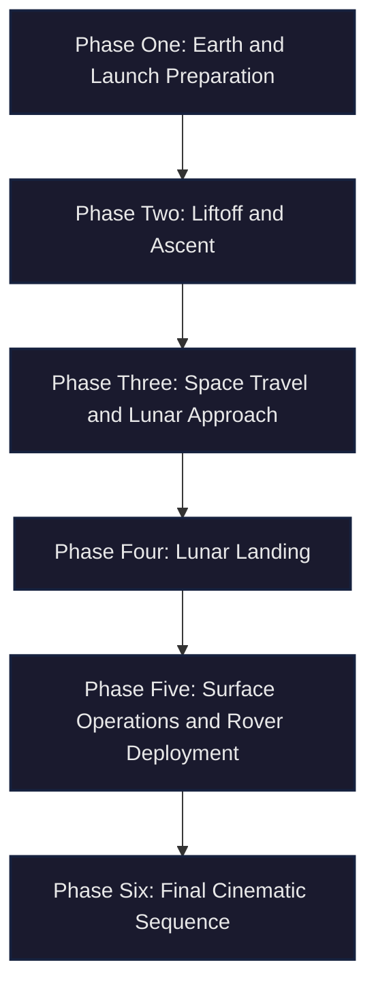

    

<h1 align="center">MOON LANDING SEQUENCE</h1>

    

    

  
 
## Table of Contents

1. [Introduction](#introduction)
2. [Base Storyline](#base-storyline)
3. [Visual Language and Production Standards](#visual-language-and-production-standards)
4. [Sequence Structure](#sequence-structure)
5. [Phase One: Earth and Launch Preparation](#phase-one-earth-and-launch-preparation)
6. [Phase Two: Liftoff and Ascent](#phase-two-liftoff-and-ascent)
7. [Phase Three: Space Travel and Lunar Approach](#phase-three-space-travel-and-lunar-approach)
8. [Phase Four: Lunar Landing](#phase-four-lunar-landing)
9. [Phase Five: Surface Operations and Rover Deployment](#phase-five-surface-operations-and-rover-deployment)
10. [Phase Six: Final Cinematic Sequence](#phase-six-final-cinematic-sequence)
11. [Audio and Voice Direction](#audio-and-voice-direction)
12. [Post-Production Notes](#post-production-notes)
13. [Complete Scene Reference Table](#complete-scene-reference-table)

 

## Introduction

This document provides a complete production blueprint for creating a cinematic moon landing sequence using generative video tools. The sequence moves from launch preparation on Earth through liftoff, space travel, lunar approach, touchdown, and surface exploration, ending with a composed final sequence.

Every scene includes a ready-to-use video generation prompt with duration, camera behavior, and visual direction. The prompts are written in plain language and can be used with any video generation system that accepts text descriptions.

The documentation is organized as a production pipeline. Each phase builds on the previous one. The final section includes a complete scene reference table that lists all shots, durations, and key visual notes in one place.

**Document parameters:** This document was prepared at temperature 0.2 to ensure precision and consistency.

 

## Base Storyline

A crewed mission leaves Earth at first light. The rocket rises through the atmosphere, separates its stages, and enters orbit. The spacecraft travels through the silence of space toward the Moon. As the Moon grows in the frame, the lander separates from the main craft and descends to the surface. The touchdown raises a slow plume of dust in low gravity. After landing, the hatch opens and a rover rolls onto the lunar surface. The sequence closes with a series of composed shots: an astronaut walking on the surface, a silhouette against the Earth, and a final title card.

The tone is austere and measured. The visuals favor cold natural light, deep shadows, and a restrained color palette. The pacing is slow and deliberate, with long takes and minimal cuts. The emotional arc moves from anticipation to wonder to quiet resolution.

 

## Visual Language and Production Standards

These settings apply to every scene unless a specific scene states otherwise.

| Element | Specification |
| :--- | :--- |
| Frame rate | 24 frames per second |
| Aspect ratio | 2.39:1 anamorphic |
| Resolution | 4K minimum |
| Color grade | Cold natural. Teal and blue in shadows, neutral midtones, warm highlights only where physically justified. |
| Film texture | Subtle grain. Mild lens flares. Slight spherical aberration. |
| Lighting | Practical sources. No stylized washes. Highlights stay cool and neutral. |
| Camera movement | Slow and controlled. Long takes preferred over quick cuts. |
| Depth of field | Deep focus for wide shots. Shallow focus for macro details. |
| Dust physics | Slow arcs and delayed settling to reflect lunar gravity. |
| Thruster color | Cool white. No warm orange. |

 

## Sequence Structure

The sequence is divided into six phases. The flow below shows how each phase connects to the next.

 

## Phase One: Earth and Launch Preparation

This phase establishes scale, anticipation, and the human element behind the launch. The camera moves from wide establishing shots to tight macro details, building tension before ignition.

### Scene 1: Launch Complex at Pre-Dawn

**Duration:** 8 seconds

**Prompt:**

Extreme wide aerial shot of a coastal rocket launch complex before dawn. Floodlights cut through cold mist. Service gantries and catwalks form dark silhouettes around the vertical rocket. The composition emphasizes scale and empty space. Slow rising crane movement from ground level to a high vantage point. Long lens compression. Muted steel blues and slate grays. Volumetric haze. Subtle film grain. Photorealistic detail. Cold natural color grade.

**Notes:** Hold the final frame for two seconds before cutting.

 

### Scene 2: Pre-Launch Detail Sequence

**Duration:** 6 seconds

**Prompt:**

A sequence of macro shots inside and around the launch facility. Frost-white vapor vents from fuel lines. Close-up of rivets and weld seams on the rocket tank. A gloved hand tightens a harness fitting. A helmet visor reflects the glow of control room monitors. Shallow depth of field throughout. Cool blue and teal practical lighting. High micro-contrast. Tactile surfaces. Photorealistic. Cold natural color grade.

**Notes:** Cut between details in rhythm with a slow pulse. Each shot lasts about one second.

 

### Scene 3: Control Room Countdown

**Duration:** 6 seconds

**Prompt:**

Medium long shot inside a dim control room. Rows of consoles face a large display showing a countdown sequence. Faces of operators lit by cool monitor glow. Reflective glass layers the image. Slow dolly push toward the main console. Static composition with subtle movement. Cold teal color palette. High dynamic range. Honest practical lighting. Photorealistic detail.

**Notes:** The countdown digits should be visible but not dominant. The focus is on the people and the atmosphere.

 

### Scene 4: Engine Ignition

**Duration:** 5 seconds

**Prompt:**

Low angle worm's-eye view under the rocket at ignition. Engine bells glow with a white-blue core and a cooler combustion halo. Ground surfaces are scorched. Shock pressure ripples through dust and heat shimmer. Light interacts realistically with scaffold and smoke. No exaggerated orange. The core stays intense white and blue with neutral spill. Slow upward camera tilt following the thrust. Dramatic geometry. Large format scale. Film grain. Photorealistic.

**Notes:** The sound of ignition should arrive one beat after the visual, reflecting the speed of sound.

 

## Phase Two: Liftoff and Ascent

This phase covers the rise from the pad through the atmosphere and into orbit. The camera moves from ground tracking to aerial follow shots and finally to exterior views of the spacecraft in space.

### Scene 5: Liftoff

**Duration:** 6 seconds

**Prompt:**

Side profile tracking shot of the rocket ascending. The vehicle rises against a cold slate sky. Condensation and exhaust form a luminous trail. Ground dust roils below then dissipates. Smooth gimbal tracking. Long focal length compresses the distance. Crisp texture on fuselage panels catching pale sunlight. Natural cold grade. Cinematic clarity. Ultra-detailed.

**Notes:** The camera moves upward at the same rate as the rocket to keep the vehicle centered.

 

### Scene 6: Aerial Follow

**Duration:** 6 seconds

**Prompt:**

Aerial follow shot from a high drone perspective. The rocket slices through a layer of stratocumulus clouds. A contrail cuts through cold blue sky. Sunlight glints as thin specular streaks on the rocket skin. Clouds backlit with soft teal rim light. Slight telephoto compression. Long continuous tracking shot. Large format framing. Naturalistic color. Photorealistic detail.

**Notes:** The rocket should appear small in the frame at the start and grow slightly as the camera catches up.

 

### Scene 7: Upper Atmosphere and Stage Separation

**Duration:** 7 seconds

**Prompt:**

Wide shot transitioning to a close view. The sky gradient shifts from deep cobalt to near black. The first stage separates and tumbles away. Separation smoke is sharp and cold white. The second stage continues upward. Earth curvature is visible low on the horizon. High clarity. Practical mechanical detail. Photorealistic. Natural cold grade.

**Notes:** The separation moment should feel mechanical and precise, not explosive.

 

### Scene 8: Orbit Establishment

**Duration:** 6 seconds

**Prompt:**

Exterior long shot of the spacecraft coasting above Earth. The curvature of Earth is visible. A thin cyan ribbon of atmosphere marks the limb. The ship stabilizes with tiny thruster puffs. Stars begin to appear. Reflections on the hull are cold and specular. Sense of silence and scale. Deep focus. Photorealistic. Large format proportions.

**Notes:** The thruster puffs should be brief and white, not fiery.

 

## Phase Three: Space Travel and Lunar Approach

This phase covers the interior of the spacecraft, the deployment of systems, the long glide through space, and the first sight of the Moon.

### Scene 9: Interior Zero Gravity

**Duration:** 7 seconds

**Prompt:**

Continuous medium shot inside the spacecraft cabin. Astronauts float with tethers attached. Instruments glow in cool blues. Slow deliberate body movements and tool checks. Aluminum textures and practical LED lights. Reflections and window glints. Single long take with steady gimbal movement. Cinematic restraint. Photorealistic detail.

**Notes:** The movement should feel weightless. Avoid fast motions.

 

### Scene 10: Solar Array Deployment

**Duration:** 6 seconds

**Prompt:**

Wide exterior shot of the spacecraft deploying solar arrays against a dense starfield. Panels unfold with mechanical clarity. The spacecraft silhouette is sharp against black space. Subtle blue rim light from distant Earth. Strong compositional symmetry. Slow crane movement around the craft. Ultra-detailed rigging and joints. Photorealistic.

**Notes:** The deployment should feel slow and controlled, not spring-loaded.

 

### Scene 11: Earth from Space

**Duration:** 6 seconds

**Prompt:**

Rear point of view slowly rotating around the spacecraft. Earth fills the lower frame with photographic oceans and cloud detail. Soft cyan limb glow. Negative space above emphasizes isolation. Measured camera movement. Natural cold grade. Large format clarity. Photorealistic.

**Notes:** The rotation should be slow enough that the viewer can study the details of Earth.

 

### Scene 12: First Sight of the Moon

**Duration:** 5 seconds

**Prompt:**

Telephoto reveal. A small grey Moon appears on the horizon then grows in the frame. Sunlight sculpts hard crater shadows. Razor contrast on regolith facets. No atmospheric haze. Stark chiaroscuro. Pristine surface texture. Cold neutral midtones. Photorealistic detail.

**Notes:** Start with the Moon as a small disc and end with it filling a third of the frame.

 

### Scene 13: Lunar Orbit Insertion

**Duration:** 6 seconds

**Prompt:**

Arc shot of the spacecraft performing an orbital insertion around the Moon. Brief white thruster pulses fire for capture. The trajectory arcs across the frame. The lunar surface increases in granularity. High fidelity of surface relief. Limb crispness. Measured pacing. Cold natural color grade. Photorealistic.

**Notes:** The thruster pulses should be short and precise. No continuous burn.

 

### Scene 14: Lander Separation

**Duration:** 5 seconds

**Prompt:**

Close mechanical sequence. The landing module detaches from the main craft. Clamps release. Shock-absorbing struts articulate. Metal textures and hydraulic detail are tactile and realistic. Composition favors geometric lines and practical lighting. Emphasis on real mechanics. Photorealistic. Natural cold grade.

**Notes:** Focus on the point of separation. Show the gap widening between the two craft.

 

## Phase Four: Lunar Landing

This phase covers the descent from orbit to the surface. It is the dramatic center of the sequence. The pacing slows, the sound drops away, and the visuals focus on dust, shadow, and contact.

### Scene 15: Descent

**Duration:** 6 seconds

**Prompt:**

Low angle descent over a mottled lunar plain. Retrorockets create a diffuse white halo of low-velocity ejecta. Dusty regolith sprays in a slow arcing plume. Harsh sunlight produces long crisp shadows across craters. No atmospheric smoke. Cold neutral palette. High microtexture on the surface. Stabilized low tracking shot. Photorealistic detail.

**Notes:** The dust should move in slow arcs, not billow like smoke on Earth.

 

### Scene 16: Touchdown

**Duration:** 6 seconds

**Prompt:**

Slow motion capture of the lander footpad making contact with the surface. A soft plume of fine dust expands and settles slowly in microgravity. The legs compress. Contact sensors flex. The frame isolates mechanical detail and lunar dust behavior. Stark chiaroscuro. Absolute black sky. Cinematic stillness after motion. Photorealistic. Large format feel.

**Notes:** Use high frame rate slow motion to capture the subtlety of the dust. The moment of contact should feel heavy and final.

 

### Scene 17: First Stillness

**Duration:** 8 seconds

**Prompt:**

Extreme wide minimal composition. The lander rests on a vast grey plain. A planetless horizon stretches in all directions. Earth appears as a small blue marble in the black sky. Immense negative space. Palpable silence. Pure geometry. Cold naturally vibrant grading. Deep tonal separation. Slow lateral dolly reveal of the lander. Photorealistic.

**Notes:** This is the first moment of stillness in the sequence. Let the silence hold. The score should be sparse or absent.

 

## Phase Five: Surface Operations and Rover Deployment

This phase moves from the lander to the surface. The hatch opens, the rover activates, and the first tracks are laid down in the regolith.

### Scene 18: Hatch and Ramp

**Duration:** 5 seconds

**Prompt:**

Medium close shot of the lander hatch. Hydraulics articulate. The ramp lowers. Interior LEDs spill neutral light across lunar dust on the ramp surface. Tactile seals and hinge motion. Slow quiet mechanical movement. Intimate close coverage. Photorealistic. Natural cold grade.

**Notes:** The light from inside the lander should be the only warm element in the frame, and it should be subtle.

 

### Scene 19: Rover Activation

**Duration:** 5 seconds

**Prompt:**

Low angle close shot of the rover powering on. Status LEDs pulse cool white and blue. Instrument arms articulate. Wheel actuators extend in crisp mechanical motion. Micro-mechanics and treads are rendered with tactile detail. Low angle micro coverage. Photorealistic. Natural cold grade.

**Notes:** The sequence of movements should feel like a machine waking up. Status lights first, then arms, then wheels.

 

### Scene 20: Rover Rolls onto the Surface

**Duration:** 6 seconds

**Prompt:**

Low tracking shot as the rover rolls down the ramp onto the regolith. Wheels sink slightly and leave distinct tracks. Dust lifts in slow arcs. The horizon is low in the frame. Earthrise is visible in the distance. Composition focuses on texture and scale. Steady follow tracking. Photorealistic. Natural cold grade.

**Notes:** The first wheel contact with the surface is the key moment. Show the track forming.

 

## Phase Six: Final Cinematic Sequence

This phase brings the sequence to a close with a series of composed shots. Each shot is a complete statement. Together they form a resolution.

### Scene 21: Astronauts Walking

**Duration:** 8 seconds

**Prompt:**

Cinematic wide shot of two astronauts in textured EVA suits walking side by side across a stark lunar plain toward a rising Earth. Each slow measured step compresses powdery regolith and leaves crisp bootprints. Micro-particles loft in graceful low-gravity arcs. Cold natural color grade. Large format feel. Deep focus. Subtle film grain. Practical LED highlights on visors. Sunlight casts long razor shadows and pale rim light on suit edges. Camera begins low tracking near bootprints then rises to a medium-wide reveal of the figures with Earthrise framed above the horizon. Photorealistic detail. Minimal motion. Meditative pacing.

**Notes:** The walk should feel slow and deliberate. Each step is an event.

 

### Scene 22: Hero Traverse and Earthrise

**Duration:** 8 seconds

**Prompt:**

Epic wide hero shot. The rover traverses a gently undulating ridge. Earthrise is framed perfectly above the horizon. Sunlight glances off metallic surfaces. Long negative space. Minimalist and monumental composition. Steady forward motion. Natural cold grade. Large format clarity. Photorealistic.

**Notes:** The rover should move from one side of the frame to the other. Earth stays fixed above the horizon.

 

### Scene 23: Final Sequence

**Duration:** 14 seconds

**Prompt:**

A continuous cinematic finale. Start with a close macro of an astronaut boot settling into powdery regolith beside a planted mission emblem. Extreme microtexture of compacted dust and crisp rim light from the low sun. Slow micro-dolly pulls back to reveal a monumental wide silhouette of the rover and astronaut on a ridge with a huge detailed Earthrise filling the sky. Strong backlight creates stark silhouettes and long cold-blue rim highlights on metallic surfaces. Measured slow crane pull-back widens the composition. Cut to a tight macro glide across a weathered mission plaque with engraved text and subtle scratches. The image dissolves into tonal black for a title card. Practical realism. Natural cold color grade. Deep focus. Subtle film grain. Photorealistic detail. Gentle micro-particle dust settling.

**Notes:** This is the closing statement. The plaque should be the last object seen before the fade. The title card should appear after a beat of black.

 

## Audio and Voice Direction

The sound design and voice work should support the visual restraint. Silence is a tool. Use it.

### Sound Design Principles

| Phase | Sound Approach |
| :--- | :--- |
| Launch preparation | Low atmospheric rumble. Distant hydraulic hisses. No music. |
| Countdown | Synchronized beeps. Low sub bass. Heartbeat-like pulse. |
| Ignition and liftoff | Deep roar. Delayed ground rumble. Wind. No music. |
| Ascent | Engine pitch rises then fades. Wind whine. |
| Space travel | Near silence. Faint hum. Micro-thruster pops. |
| Lunar approach | Silence with sparse low tones. |
| Descent | Thin rocket tone. Dust whispers. |
| Touchdown | Muffled mechanical thud. Then silence. |
| Surface operations | Soft motors. Granular footsteps. Suit servos. |
| Final sequence | Sparse orchestral pad. Rising harmonic swells. Silence at the end. |

### Voice Direction

The sequence includes a short voiceover and a launch communication script.

**Voiceover tone:** Warm authority with a sense of wonder. Slow pace, approximately 85 to 95 words per minute. The emotional arc moves from awe to pride to quiet inspiration. The final line is gentle and breathy.

**Voiceover script:**

> We looked up and we chose to reach.
>
> We built fire into flight and turned dreams into trajectory.
>
> Tonight, on this quiet horizon, we stand as explorers of what comes next.
>
> Every calculation, every step, every brave decision carried us here.
>
> We place our footprints in this dust and our future in the stars.
>
> This is our greatest marvel. Not the machines we launch, but the courage that launches us.
>
> We move forward together. We reach higher together.
>
> And we begin again beyond Earth.

**Launch communication script:**

The launch communication script uses two voices. Mission Command is male, grounded, calm authority, NASA-style cadence. Flight Crew is female, composed, warm, determined. The pace is deliberate with cinematic pauses between lines.

| Speaker | Line |
| :--- | :--- |
| Mission Command | Command to crew, comms check. You are go for terminal countdown. |
| Flight Crew | Loud and clear, Command. Cabin secure. Heart rate steady. We are ready. |
| Mission Command | Copy that. Guidance is green. Navigation locked. All systems nominal. |
| Flight Crew | Guidance confirmed. Thrusters armed. Standing by for ignition. |
| Mission Command | T-minus 20 seconds. You are go for launch. |
| Flight Crew | Go for launch. For everyone watching below, we carry you with us. |
| Mission Command | T-minus 10. 9. Main engine sequence start. |
| Flight Crew | Ignition sequence confirmed. Vibration rising. We are with you. |
| Mission Command | 5. 4. 3. All engines running. 2. 1. Liftoff. |
| Flight Crew | We have liftoff. Leaving the cradle of Earth. |
| Mission Command | Trajectory stable. You are riding true. |
| Flight Crew | Copy, Command. We are on our way to the Moon. |
| Mission Command | Godspeed, crew. The world is with you. |
| Flight Crew | And we carry the world forward. |

 

## Post-Production Notes

These notes apply to the editing and finishing stage.

### Color and Texture

- Apply a consistent cold natural grade across all scenes.
- Shadows lean teal and blue.
- Midtones stay neutral.
- Warm highlights appear only where physically justified, such as engine cores or reflected sunlight.
- Add subtle film grain to every shot.
- Use mild lens flares and spherical aberration to sell the practical lighting.

### Dust and Particle Physics

- Dust in low gravity moves in slow arcs.
- Particles settle slowly and do not billow like smoke on Earth.
- Secondary lofting around boots and wheels should be soft and delayed.
- Keep particle density low. Fewer particles read as more realistic.

### Earth and Lunar Surface

- Earth should be rendered with photographic fidelity for oceans and clouds.
- Earth should be slightly desaturated relative to the foreground to maintain the cold aesthetic.
- The lunar surface should have high-frequency detail on regolith, rocks, and crater edges.
- Shadows on the Moon should be sharp and black.

### Transitions

- Use match cuts where possible. For example, a pull-back from a macro detail can match to a wider shot moving in the same direction.
- Avoid dissolves except for the final fade to black.
- The final cut to black should be abrupt, followed by a beat of silence, then the title card.

 

## Complete Scene Reference Table

This table lists every scene in the sequence with duration, phase, and key visual notes.

| Scene | Phase | Duration | Key Visual | Camera |
| :--- | :--- | :--- | :--- | :--- |
| 1 | Earth and Launch Preparation | 8s | Launch complex at pre-dawn | Rising crane, long lens |
| 2 | Earth and Launch Preparation | 6s | Macro details of fuel lines, harness, visor | Macro lenses, tight cuts |
| 3 | Earth and Launch Preparation | 6s | Control room countdown | Slow dolly push |
| 4 | Earth and Launch Preparation | 5s | Engine ignition | Low angle, upward tilt |
| 5 | Liftoff and Ascent | 6s | Side profile liftoff | Gimbal tracking |
| 6 | Liftoff and Ascent | 6s | Aerial follow through clouds | Telephoto drone |
| 7 | Liftoff and Ascent | 7s | Stage separation | Wide to close |
| 8 | Liftoff and Ascent | 6s | Orbit establishment | Long lens exterior |
| 9 | Space Travel and Lunar Approach | 7s | Interior zero gravity | Single long take, gimbal |
| 10 | Space Travel and Lunar Approach | 6s | Solar array deployment | Slow crane arc |
| 11 | Space Travel and Lunar Approach | 6s | Earth from space | Slow controlled rotation |
| 12 | Space Travel and Lunar Approach | 5s | First sight of Moon | Telephoto push |
| 13 | Space Travel and Lunar Approach | 6s | Lunar orbit insertion | Slow arc dolly |
| 14 | Space Travel and Lunar Approach | 5s | Lander separation | Close mechanical |
| 15 | Lunar Landing | 6s | Descent with dust plume | Low tracking |
| 16 | Lunar Landing | 6s | Touchdown slow motion | High frame rate macro |
| 17 | Lunar Landing | 8s | First stillness | Ultra-wide slow dolly |
| 18 | Surface Operations and Rover Deployment | 5s | Hatch and ramp | Intimate close |
| 19 | Surface Operations and Rover Deployment | 5s | Rover activation | Low angle micro |
| 20 | Surface Operations and Rover Deployment | 6s | Rover rolls onto surface | Low dolly track |
| 21 | Final Cinematic Sequence | 8s | Astronauts walking | Low to medium-wide rise |
| 22 | Final Cinematic Sequence | 8s | Hero traverse and Earthrise | Wide dolly tracking |
| 23 | Final Cinematic Sequence | 14s | Final sequence and fade | Macro to crane back |

 

## Summary

This document provides everything needed to create a complete moon landing sequence using generative video tools. The base storyline gives the narrative arc. The scene-by-scene prompts give the visual instructions. The audio and post-production notes give the finishing direction. The reference table gives a single view of the entire sequence.

The sequence runs approximately 145 seconds in total. It can be extended or shortened by adjusting scene durations or omitting scenes. Each scene is designed to work on its own, so the order can be rearranged or scenes can be used individually for shorter edits.

The visual approach is consistent throughout: cold natural light, slow camera movement, deep shadows, and a restrained color palette. The sound design relies on silence as much as on sound. The result is a sequence that feels measured, realistic, and composed.

    
